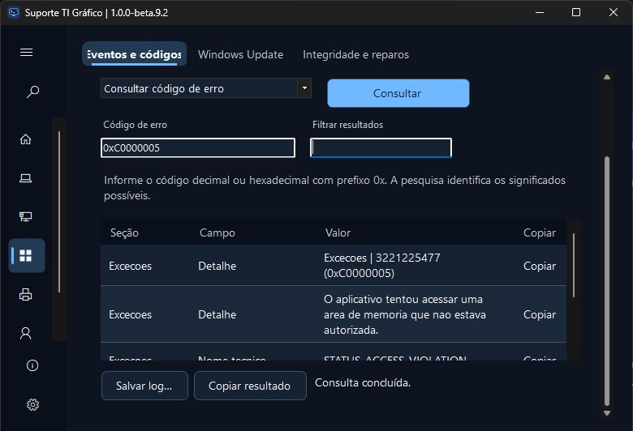
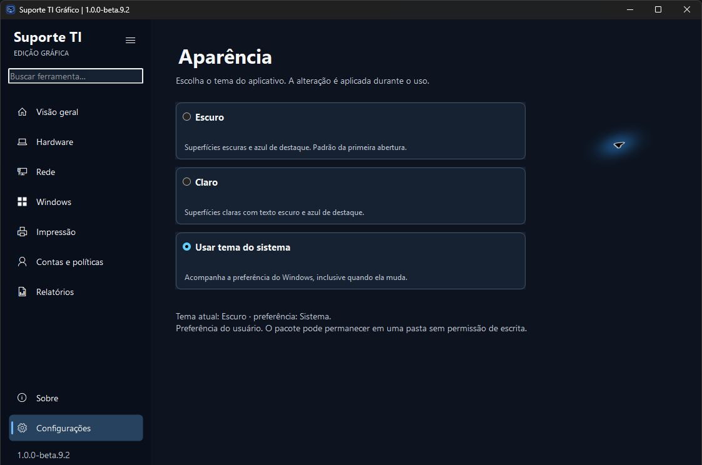

# Suporte TI Gráfico

**Versão atual · 1.0.0-beta.9.2**

**Windows x64 · edição portátil · prévia de homologação**

Ferramenta gráfica de diagnóstico e manutenção do Windows para técnicos de TI e uso pessoal. Baseada no [Suporte TI para terminal](https://github.com/gustavo-brandao/SuporteTI), com interface própria, distribuição portátil e ciclo de versões independente.

**[Baixar ZIP portátil](https://github.com/gustavo-brandao/SuporteTI-Desktop/releases/download/v1.0.0-beta.9.2/SuporteTI-Grafico-1.0.0-beta.9.2-win-x64.zip)** · [SHA-256](https://github.com/gustavo-brandao/SuporteTI-Desktop/releases/download/v1.0.0-beta.9.2/SuporteTI-Grafico-1.0.0-beta.9.2-win-x64.zip.sha256) · [Notas da versão](https://github.com/gustavo-brandao/SuporteTI-Desktop/releases/tag/v1.0.0-beta.9.2)



A beta.9.2 inicia a estrutura do dashboard de monitoramento: paleta azul escura, navegação lateral adaptável, abas em uma linha e títulos com hierarquia mais clara. Em janelas baixas, o conteúdo usa rolagem para preservar uma área legível de resultados. As 44 operações, os formulários por contexto e a elevação por operação permanecem disponíveis.

Esta entrega corresponde à **primeira etapa visual**. As barras horizontais de CPU/RAM e o velocímetro estão aprovados para a próxima etapa; os gráficos atuais continuam sendo curvas de monitoramento e progresso.

## Começar

1. Baixe o ZIP portátil da versão acima.
2. Extraia todo o conteúdo para uma pasta local ou pendrive. Mantenha **Modulos** e **Documentacao** ao lado do executável.
3. Abra **Suporte TI Grafico.exe**. O pacote inclui o runtime .NET e usa o Windows PowerShell 5.1 da máquina.
4. Use **Salvar log…** quando precisar guardar o resultado de uma consulta. Operações que exigem permissões administrativas apresentam o UAC ao serem executadas.

Para conferir a integridade, execute `Get-FileHash -Algorithm SHA256` sobre o ZIP e compare com o arquivo `.sha256` da mesma release. Extraia a pasta completa; o aplicativo não possui instalador.

A beta está sem assinatura Authenticode. Os testes de laboratório com intervenções reais, elevação com outra conta e execução por compartilhamento seguem na [matriz de homologação](Suporte%20TI%20Grafico/Testes/HOMOLOGACAO.md).

## O que a ferramenta faz

- **Visão geral e Hardware** — inventário, monitor de CPU e memória, saúde SMART, gráficos de ocupação e mapa de pastas.
- **Rede e Windows** — adaptadores, ping, eventos, pesquisa de códigos de erro, Windows Update e integridade.
- **Impressão** — diagnóstico, reinício do spooler e limpeza de fila selecionada.
- **Contas e políticas** — GPO do usuário e computador, perfis locais e login automático.
- **Relatórios** — exportação TXT, HTML e EVTX.

Use a busca para encontrar uma ferramenta pelo nome. As abas agrupam as operações por assunto e o indicador **(UAC)** identifica as ferramentas administrativas.

**Ctrl+K** abre a busca mesmo com o menu recolhido. A lateral se recolhe abaixo de 1.000 pixels efetivos de largura da área cliente; o botão de menu permite alternar manualmente. A escolha manual permanece na faixa de largura atual. Abaixo desse limite, os ícones conservam seus nomes acessíveis e dicas. Sobre e Configurações ficam na base da lateral; a lista de grupos pode rolar em janelas baixas.

As abas permanecem em uma linha. Quando não couberem, use os controles nativos de rolagem ou **Ctrl+Tab/Ctrl+Shift+Tab**. A largura e o DPI determinam quanto conteúdo fica visível. A janela mantém o mínimo de 780 × 560; resultados e comandos adicionais continuam acessíveis pela rolagem.

O seletor reúne **35 entradas para as 44 operações**. A busca continua encontrando todas elas e preenche o formulário correspondente. Selecionar um modo ou ação prepara a operação para revisão. Os atalhos de diagnóstico permitem consultar antes de fazer alterações.

O filtro aguarda 200 ms sem novas teclas antes de atualizar a tabela. Limpar o campo restaura os registros imediatamente. Os avisos de leitura parcial permanecem visíveis. Confira as [medições da beta.8](docs/DESEMPENHO-beta8.md), com três amostras por cenário e as pendências de homologação.

Use a coluna **Copiar** para um valor, **Ctrl+C** para as linhas selecionadas ou **Copiar resultado** para o relatório completo. O menu de contexto oferece as mesmas ações e o rodapé confirma a cópia. O clique nos códigos de erro abre sua explicação.

## Teste de velocidade

Em **Rede → Conectividade → Velocidade da internet**, acompanhe latência HTTPS, download e upload. São quatro transferências paralelas por direção, por até dez segundos ou **512 MiB por direção (até 1 GiB total)**. O painel mostra a fase, Mbps, tempo e dados; cancelamento, cópia e **Salvar log…** permanecem disponíveis. O resultado estima a vazão útil até a Cloudflare e pode variar com Wi-Fi, VPN, proxy e tráfego concorrente.

O monitor mantém amostras reais de CPU e memória a cada segundo, com movimento suave entre os pontos. As transições respeitam a preferência de animações do Windows; alto contraste e sessões remotas usam apresentação sem movimento decorativo.

## Aparência

Em **Configurações → Aparência**, escolha **Escuro**, **Claro** ou **Sistema**. A primeira abertura usa Escuro. A preferência é salva por usuário e a troca é aplicada durante o uso, preservando resultados. Alto contraste do Windows tem prioridade. O pacote continua portátil, com configuração fora da pasta do executável.



As capturas são da beta.9.2 em execução; o rodapé com a identificação da estação foi recortado. Os mockups ficam na documentação de propostas. Título, ícone e apresentação foram conferidos nos três modos. Controles e diálogos nativos podem variar conforme o Windows; o roteiro de homologação registra os limites da validação.

## Requisitos e arquitetura

| Componente | Implementação |
| --- | --- |
| Distribuição | Windows x64, ZIP portátil com .NET Desktop Runtime incluído |
| Interface | C# / .NET 10 / Windows Forms, com controles nativos e desenho dos componentes visuais |
| Consultas e manutenção | Módulos Windows PowerShell 5.1 locais, com contrato JSON versão 1 e operações permitidas explicitamente |
| Monitor e internet | Coleta nativa em C#; teste HTTPS até a Cloudflare, iniciado manualmente |
| Permissões | Janela principal na sessão atual; processo separado e validado para operações com UAC |
| Preferências | Tema por usuário em LocalAppData; resultados em memória e exportação manual |

O ambiente de validação local é Windows 11 Enterprise 25H2 x64. Windows 10, execução em VM limpa/offline, pendrive físico, conta administrativa distinta e matriz completa de DPI/alto contraste permanecem em homologação. PowerShell 7 ainda não acompanha o pacote.

## Compilação e testes

Com o SDK .NET 10 em Windows x64, a partir da raiz do repositório:

```powershell
dotnet build '.\Suporte TI Grafico\SuporteTI.Grafico.csproj' -c Release
dotnet run --project '.\Suporte TI Grafico\Testes\SuporteTI.Grafico.Testes.csproj' -c Release -- --exigir-cim
& '.\Suporte TI Grafico\Testes\Testar-Intervencoes.ps1'
& '.\Suporte TI Grafico\Construcao\Publicar.ps1'
```

O publicador gera ZIP e SHA-256 em `Suporte TI Grafico/outputs`; uma versão existente não é sobrescrita. A suíte verifica contrato, catálogo, permissões, falhas, cancelamento, logs, medições e consultas reais. A etapa local registrou **153 testes automatizados e 13 simulações de intervenção aprovados**. Os testes da janela e suas pendências estão em [Resultados](Suporte%20TI%20Grafico/Testes/RESULTADO.md); simulações não substituem manutenção real em laboratório.

## Documentação e código

- [Manual, requisitos e compilação](Suporte%20TI%20Grafico/README.md)
- [Escopo e paridade com a edição CLI](Suporte%20TI%20Grafico/ESCOPO.md)
- [Resultados dos testes](Suporte%20TI%20Grafico/Testes/RESULTADO.md)
- [Roteiro de homologação](Suporte%20TI%20Grafico/Testes/HOMOLOGACAO.md)
- [Histórico das prévias](docs/PLANEJAMENTO.md)
- [Proposta de dashboard: cinco menus amplos/compactos e análise das 44 operações](docs/propostas-visuais/2026-11-10/conjunto-monitoramento/README.md) — conceitos para avaliação, separados das capturas reais acima.

O projeto usa WinForms em C# com .NET 10 e reaproveita módulos em Windows PowerShell 5.1. A base de referência é a edição CLI 0.1.22. [Revisão de referência](https://github.com/gustavo-brandao/SuporteTI/tree/1e3e0109e8135a5b3a80fdf0f0a1b1dab7f6962e)

## Créditos e licença

Desenvolvido por **Gustavo Brandão Gimenez**, com contribuições do **OpenAI Codex** na implementação, nos testes e na documentação.

Código sob a [licença MIT](LICENSE). O smartmontools é distribuído com [licença própria](Ferramentas/smartmontools/doc/COPYING.txt) e código-fonte na pasta de terceiros.
