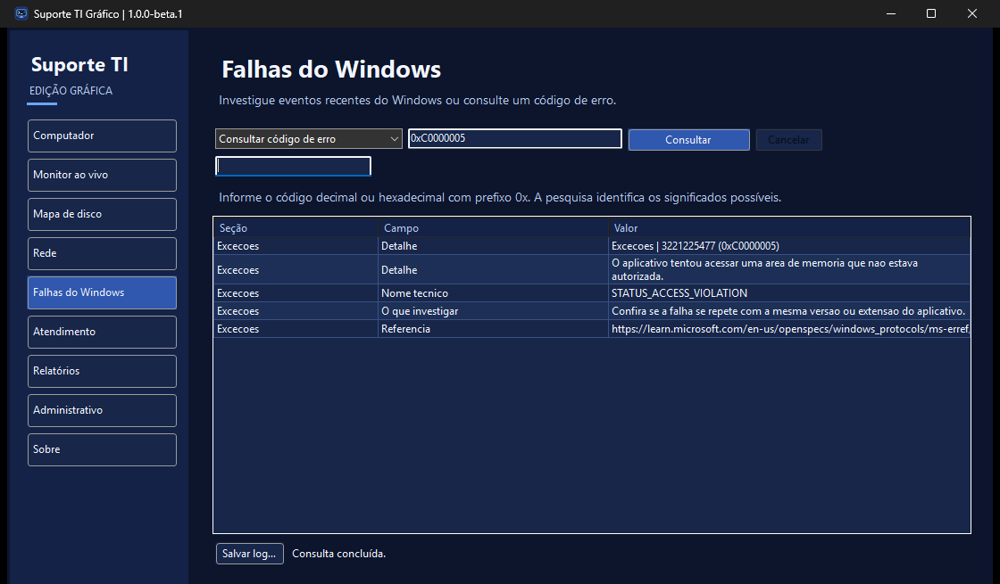
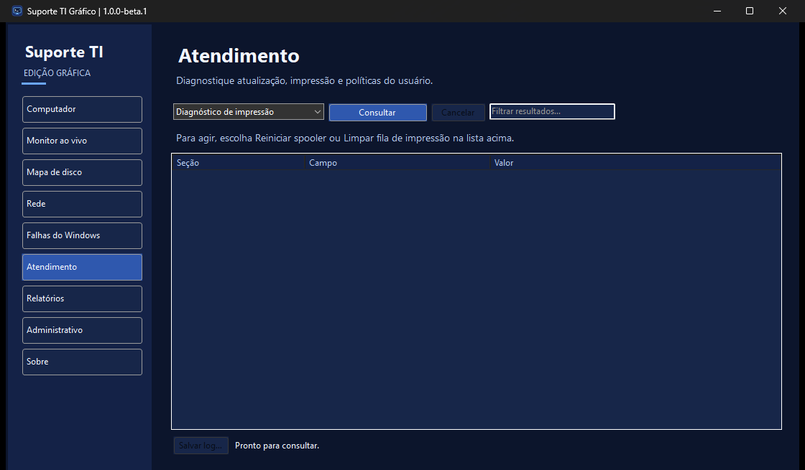

# Suporte TI Gráfico

**Versão atual · 1.0.0-beta.1**

**Windows x64 · edição portátil · prévia de homologação**

Ferramenta gráfica de diagnóstico e manutenção do Windows para técnicos de TI e uso pessoal. Baseada no [Suporte TI para terminal](https://github.com/gustavo-brandao/SuporteTI), com interface própria, distribuição portátil e ciclo de versões independente.

**[Baixar ZIP portátil](https://github.com/gustavo-brandao/SuporteTI-Desktop/releases/download/v1.0.0-beta.1/SuporteTI-Grafico-1.0.0-beta.1-win-x64.zip)** · [SHA-256](https://github.com/gustavo-brandao/SuporteTI-Desktop/releases/download/v1.0.0-beta.1/SuporteTI-Grafico-1.0.0-beta.1-win-x64.zip.sha256) · [Notas da versão](https://github.com/gustavo-brandao/SuporteTI-Desktop/releases/tag/v1.0.0-beta.1)

## Começar

1. Baixe o ZIP portátil da versão acima.
2. Extraia todo o conteúdo para uma pasta local ou pendrive. Mantenha **Modulos** e **Documentacao** ao lado do executável.
3. Abra **Suporte TI Grafico.exe**. O pacote inclui o runtime .NET e usa o Windows PowerShell 5.1 da máquina.
4. Use **Salvar log…** quando precisar guardar o resultado de uma consulta. Operações que exigem permissões administrativas apresentam o UAC ao serem executadas.

A beta está sem assinatura Authenticode. Os testes de laboratório com intervenções reais, elevação com outra conta e execução por compartilhamento seguem na [matriz de homologação](Suporte%20TI%20Grafico/Testes/HOMOLOGACAO.md).

## O que a ferramenta faz

- **Computador e discos** — inventário, monitor de CPU e memória, saúde SMART, gráficos de ocupação e mapa de pastas.
- **Rede e falhas** — adaptadores, ping, eventos do Windows e consulta automática de códigos de erro.
- **Atendimento** — diagnóstico de impressão, reinício do spooler, limpeza de fila selecionada e Windows Update.
- **Relatórios e administrativo** — exportação TXT, HTML e EVTX, políticas de grupo e operações de manutenção com confirmação.

## Documentação e código

- [Manual, requisitos e compilação](Suporte%20TI%20Grafico/README.md)
- [Escopo e paridade com a edição CLI](Suporte%20TI%20Grafico/ESCOPO.md)
- [Resultados dos testes](Suporte%20TI%20Grafico/Testes/RESULTADO.md)
- [Roteiro de homologação](Suporte%20TI%20Grafico/Testes/HOMOLOGACAO.md)
- [Histórico das prévias](docs/PLANEJAMENTO.md)

O projeto usa WinForms em C# com .NET 10 e reaproveita módulos em Windows PowerShell 5.1. A base de referência é a edição CLI 0.1.22. [Revisão de referência](https://github.com/gustavo-brandao/SuporteTI/tree/1e3e0109e8135a5b3a80fdf0f0a1b1dab7f6962e)

## Créditos e licença

Desenvolvido por **Gustavo Brandão Gimenez**, com contribuições do **OpenAI Codex** na implementação, nos testes e na documentação.

Código sob a [licença MIT](LICENSE). O smartmontools é distribuído com [licença própria](Ferramentas/smartmontools/doc/COPYING.txt) e código-fonte na pasta de terceiros.
