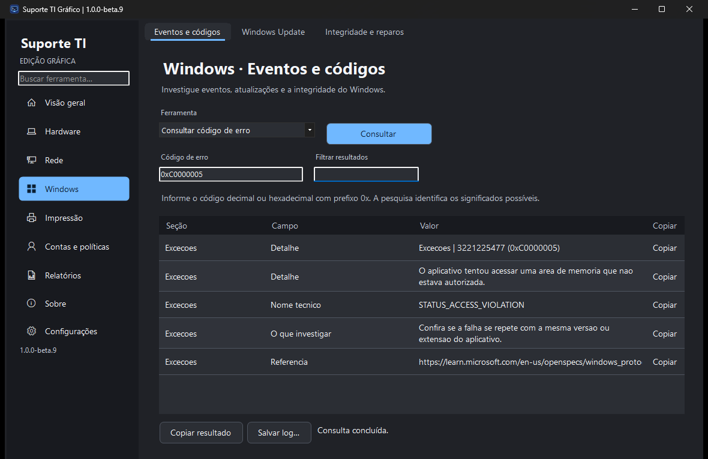
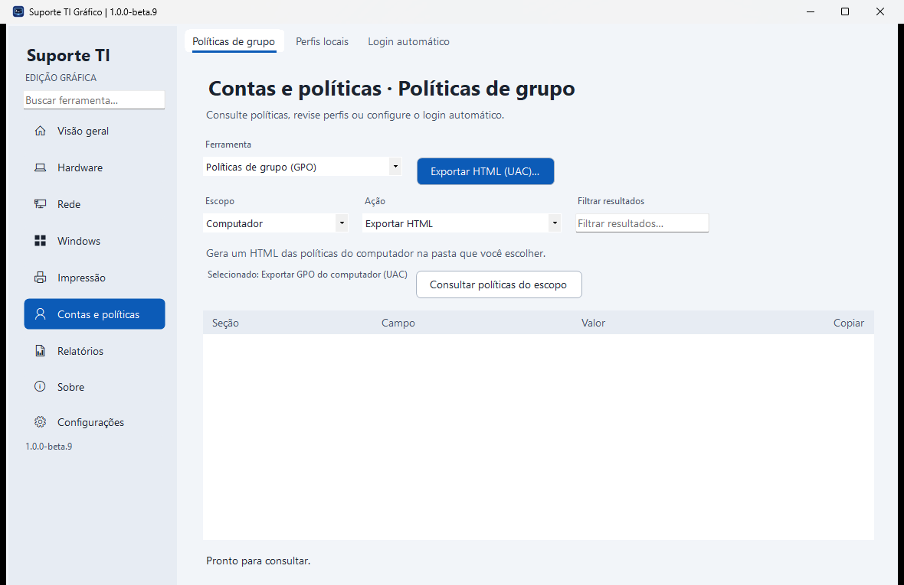
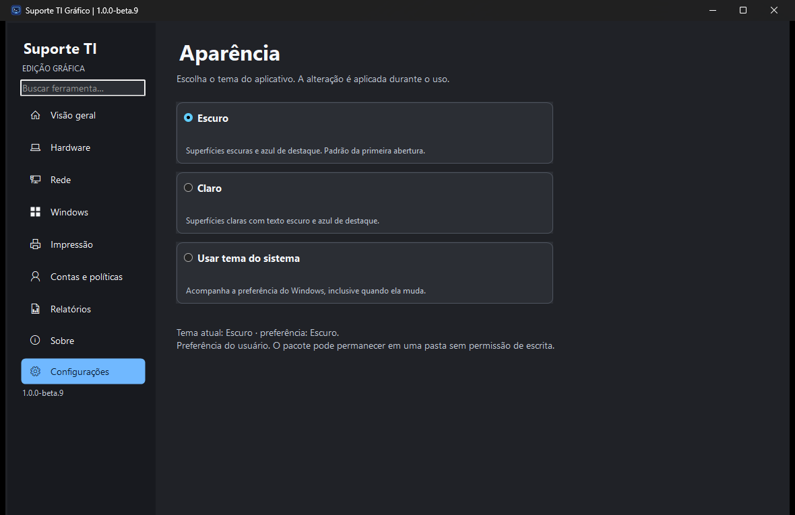

# Suporte TI Gráfico

**Versão atual · 1.0.0-beta.9**

**Windows x64 · edição portátil · prévia de homologação**

Ferramenta gráfica de diagnóstico e manutenção do Windows para técnicos de TI e uso pessoal. Baseada no [Suporte TI para terminal](https://github.com/gustavo-brandao/SuporteTI), com interface própria, distribuição portátil e ciclo de versões independente.

**[Baixar ZIP portátil](https://github.com/gustavo-brandao/SuporteTI-Desktop/releases/download/v1.0.0-beta.9/SuporteTI-Grafico-1.0.0-beta.9-win-x64.zip)** · [SHA-256](https://github.com/gustavo-brandao/SuporteTI-Desktop/releases/download/v1.0.0-beta.9/SuporteTI-Grafico-1.0.0-beta.9-win-x64.zip.sha256) · [Notas da versão](https://github.com/gustavo-brandao/SuporteTI-Desktop/releases/tag/v1.0.0-beta.9)

A beta.9 traz um visual inspirado no Windows 11: superfícies neutras, azul de destaque, navegação com ícones, botões arredondados e abas com seleção e foco visíveis. Os formulários preservam o escopo, a ação e a indicação de UAC antes de executar.

## Começar

1. Baixe o ZIP portátil da versão acima.
2. Extraia todo o conteúdo para uma pasta local ou pendrive. Mantenha **Modulos** e **Documentacao** ao lado do executável.
3. Abra **Suporte TI Grafico.exe**. O pacote inclui o runtime .NET e usa o Windows PowerShell 5.1 da máquina.
4. Use **Salvar log…** quando precisar guardar o resultado de uma consulta. Operações que exigem permissões administrativas apresentam o UAC ao serem executadas.

A beta está sem assinatura Authenticode. Os testes de laboratório com intervenções reais, elevação com outra conta e execução por compartilhamento seguem na [matriz de homologação](Suporte%20TI%20Grafico/Testes/HOMOLOGACAO.md).

## O que a ferramenta faz

- **Visão geral e Hardware** — inventário, monitor de CPU e memória, saúde SMART, gráficos de ocupação e mapa de pastas.
- **Rede e Windows** — adaptadores, ping, eventos, pesquisa de códigos de erro, Windows Update e integridade.
- **Impressão** — diagnóstico, reinício do spooler e limpeza de fila selecionada.
- **Contas e políticas** — GPO do usuário e computador, perfis locais e login automático.
- **Relatórios** — exportação TXT, HTML e EVTX.

Use a busca para encontrar uma ferramenta pelo nome. As abas agrupam as operações por assunto e o indicador **(UAC)** identifica as ferramentas administrativas.

O seletor reúne **35 entradas para as 44 operações**. A busca continua encontrando todas elas e preenche o formulário correspondente. Selecionar um modo ou ação prepara a operação para revisão. Os atalhos de diagnóstico permitem consultar antes de fazer alterações.

O filtro aguarda 200 ms sem novas teclas antes de atualizar a tabela. Limpar o campo restaura os registros imediatamente. Os avisos de leitura parcial permanecem visíveis. Confira as [medições da beta.8](docs/DESEMPENHO-beta8.md), com três amostras por cenário e as pendências de homologação.

Use a coluna **Copiar** para um valor, **Ctrl+C** para as linhas selecionadas ou **Copiar resultado** para o relatório completo. O menu de contexto oferece as mesmas ações e o rodapé confirma a cópia. O clique nos códigos de erro abre sua explicação.

## Aparência

Em **Configurações → Aparência**, escolha **Escuro**, **Claro** ou **Sistema**. A primeira abertura usa Escuro. A preferência é salva por usuário e a troca é aplicada durante o uso, preservando resultados. Alto contraste do Windows tem prioridade. O pacote continua portátil, com configuração fora da pasta do executável.

As capturas mostram a versão atual em execução. Título, ícone e abas foram revisados nos três modos; janelas e materiais nativos podem variar conforme a versão e as configurações do Windows.

## Documentação e código

- [Manual, requisitos e compilação](Suporte%20TI%20Grafico/README.md)
- [Escopo e paridade com a edição CLI](Suporte%20TI%20Grafico/ESCOPO.md)
- [Resultados dos testes](Suporte%20TI%20Grafico/Testes/RESULTADO.md)
- [Roteiro de homologação](Suporte%20TI%20Grafico/Testes/HOMOLOGACAO.md)
- [Histórico das prévias](docs/PLANEJAMENTO.md)

O projeto usa WinForms em C# com .NET 10 e reaproveita módulos em Windows PowerShell 5.1. A base de referência é a edição CLI 0.1.22. [Revisão de referência](https://github.com/gustavo-brandao/SuporteTI/tree/1e3e0109e8135a5b3a80fdf0f0a1b1dab7f6962e)

## Créditos e licença

Desenvolvido por **Gustavo Brandão Gimenez**, com contribuições do **OpenAI Codex** na implementação, nos testes e na documentação.

Código sob a [licença MIT](LICENSE). O smartmontools é distribuído com [licença própria](Ferramentas/smartmontools/doc/COPYING.txt) e código-fonte na pasta de terceiros.
