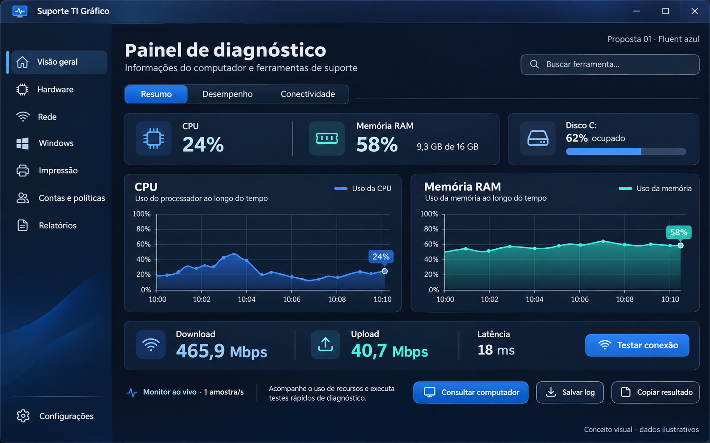
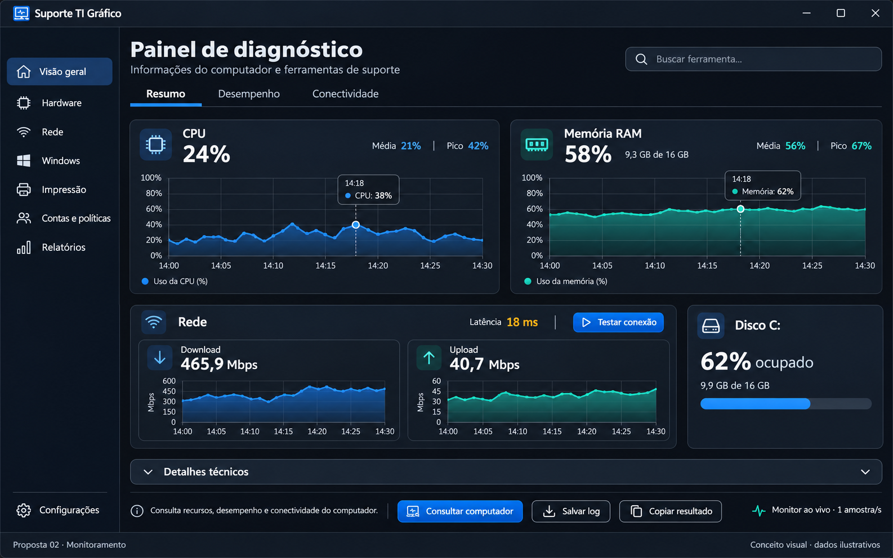
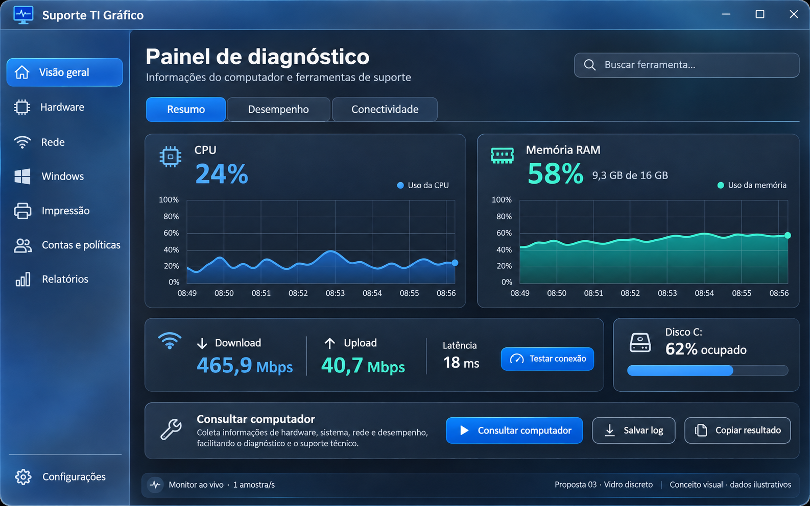
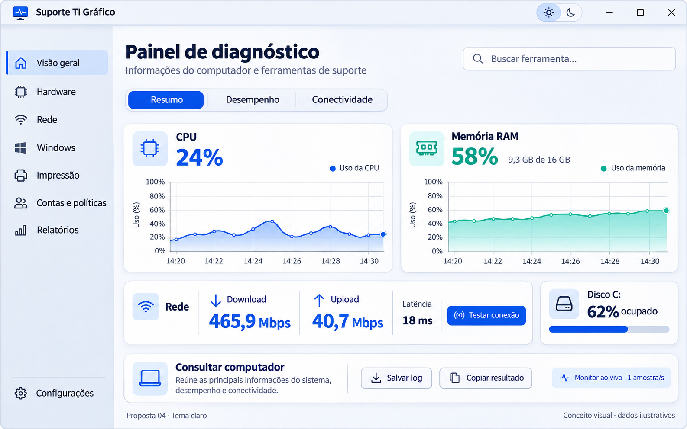
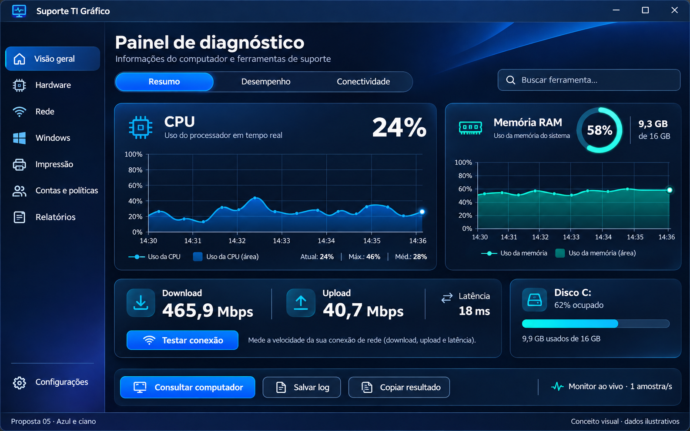

# Propostas visuais para aprovação

Documento de pesquisa e conceitos. O aplicativo permanece na implementação atual; as imagens propostas não são capturas de funcionalidades novas. Todos os números dos conceitos são ilustrativos.

**Escolha posterior do usuário:** Dashboard de monitoramento (proposta 2), com adaptação ao tamanho da janela e menos informações simultâneas nas telas menores. A nova [galeria de cinco menus responsivos](propostas-visuais/2026-11-10/menus-responsivos/README.md) detalha essa direção para avaliação. A recomendação ao final deste documento registra a análise anterior à escolha.

## Direções visuais

1. **Fluent azul:** composição de aplicativo Windows contemporâneo, com superfícies azul-escuras, cartões bem definidos e gráficos em azul e verde-água.
2. **Dashboard de monitoramento:** apresentação mais técnica e densa, com gráficos maiores, unidades, comparações e detalhes expansíveis.
3. **Vidro discreto:** profundidade e material translúcido na moldura e navegação, mantendo dados sobre superfícies sólidas.
4. **Claro contemporâneo:** alternativa clara com azul, cartões brancos e contraste forte; o tema escuro continua sendo o padrão do projeto.
5. **Painel azul e ciano:** composição assimétrica, gráfico principal destacado, memória em cartão complementar e resultados de rede equilibrados.

As cinco imagens foram geradas com a ferramenta integrada **imagegen**, usando o mesmo conteúdo principal para permitir comparação. Os [prompts completos](propostas-visuais/2026-11-10/prompts.json) foram preservados. A aprovação do visual não implica migração automática de tecnologia. A revisão não altera a versão nem publica uma atualização.

## Galeria

### 1. Fluent azul

### 2. Dashboard de monitoramento

### 3. Vidro discreto

### 4. Claro contemporâneo

### 5. Painel azul e ciano

As imagens representam direção estética. Datas, escalas, números, ícones e estados ilustrativos precisam de revisão na implementação; não são uma especificação do comportamento dos coletores. Uma imagem estática também não demonstra fluidez, consumo de recursos ou acessibilidade de uma transição.

## Diagnóstico da interface atual

A revisão considerou o código e as capturas reais da beta.9.1. O aplicativo usa WinForms/C# e .NET 10, com controles personalizados e desenhos em System.Drawing. A base tipográfica é Segoe UI 10 pt; os títulos usam 20 pt e negrito. As abas continuam sendo um TabControl, com desenho próprio e múltiplas linhas. A animação de entrada altera o Padding do conteúdo durante 180 ms.

Os pontos que mais limitam o resultado visual são:

- **A mesma composição para ferramentas diferentes.** Formulário, seletor e tabela dominam até fluxos que deveriam apresentar indicadores e visualizações específicas.
- **Títulos e espaços repetidos.** Hardware/Desempenho e Monitor ao vivo aparecem em dois cabeçalhos grandes. Essa área poderia acomodar leituras e gráficos.
- **Gráficos sem hierarquia suficiente.** A leitura atual fica pequena; faltam eixo temporal, interação para consultar pontos e melhor organização das informações complementares. No início, poucos pontos aparecem numa faixa estreita à direita de uma janela de 60 amostras.
- **Resultado de rede desequilibrado.** O último valor de upload é grande, enquanto download e upload juntos ficam numa linha menor. A curva de download é descartada visualmente quando começa a fase de upload.
- **Abas com comportamento antigo em janela estreita.** O controle nativo pode redistribuir as linhas e alterar a posição visual das guias. Uma barra com sequência estável e menu de excedentes seria mais previsível.
- **Movimento pouco perceptível.** Deslocar o Padding transmite uma mudança pequena e provoca novos cálculos de layout durante a animação. Isso difere de uma composição com transformação e opacidade.

Essas observações são de composição e implementação, não provas de lentidão. O desempenho precisa ser medido antes de escolher outra biblioteca ou plataforma.

## Referências e interpretação

| Referência | O que aproveitar | Aplicação no Suporte TI |
| --- | --- | --- |
| [Files](https://files.community/) e seu [repositório](https://github.com/files-community/Files) | Navegação, busca, barra de ferramentas e identidade de janela coerentes | Organizar a estrutura principal sem transformar cada ferramenta num formulário genérico |
| [DevToys](https://github.com/DevToys-app/DevToys) | Ferramentas agrupadas por finalidade, com experiência específica por tarefa | Páginas próprias para monitor, rede, eventos e impressão |
| [PowerToys](https://github.com/microsoft/PowerToys) | Clareza de configurações e organização de muitas ferramentas | Resumos curtos e contexto junto às opções avançadas |
| [WinUI Gallery](https://github.com/microsoft/WinUI-Gallery) | Controles e demonstrações do sistema Fluent | Referência de seleção, estados, foco e transições |
| [Grafana: séries temporais](https://grafana.com/docs/grafana/latest/visualizations/panels-visualizations/visualizations/time-series/) | Eixos, unidades, legenda, preenchimento, consulta de pontos e tratamento de lacunas | Fazer gráficos úteis para diagnóstico, com hierarquia visual |
| [shadcn: gráficos](https://ui.shadcn.com/charts/area) | Composição de cartões, espaço e apresentação de dados | Inspiração visual; seus componentes web não são pacotes WinForms |

As discussões consultadas no Reddit não constituem consenso nem benchmark. Elas mostram opiniões e problemas que merecem teste. Em [My Dashboard](https://www.reddit.com/r/UI_Design/comments/1tc2t3f/my_dashboard/), participantes apontam excesso de dados, fontes pequenas e falta de escala nos gráficos. Em [Concept: Dark mode SaaS dashboard](https://www.reddit.com/r/UI_Design/comments/1s1pixd/concept_dark_mode_saas_dashboard_for_my_portfolio/), há divergência entre personalidade visual e clareza funcional. Em [redesign de analytics](https://www.reddit.com/r/Frontend/comments/1vyh8x0/i_redesigned_analytics_page_in_my_open_source/), surgem críticas a contraste e hierarquia. A [discussão sobre Fluent e Windows 11](https://www.reddit.com/r/Windows11/comments/1qmdk0g/thoughts_on_windows_11s_ux_fluent_design_and_dark/) também mostra preferências conflitantes sobre materiais e consistência.

Minha interpretação: o salto visual depende de composição, legibilidade e gráficos bem apresentados. Transparência e efeitos podem complementar esse trabalho; não substituem essa estrutura. A proposta 5 oferece maior personalidade; a 2 é a referência mais útil para a organização técnica. A 1 é a alternativa mais próxima do Fluent tradicional. A 4 orienta o tema claro, mantendo o escuro como padrão.

## Tipografia, cores e ícones

Proponho **Segoe UI Variable quando disponível**, com alternativa Segoe UI. A recomendação oficial combina hierarquia, alinhamento e peso, não apenas troca de família. Tamanhos abaixo são propostas em pixels efetivos a 100%, sujeitos a validação; no WinForms é necessário converter corretamente pontos e DPI. [Tipografia do Windows](https://learn.microsoft.com/en-us/windows/apps/design/signature-experiences/typography).

| Uso | Proposta |
| --- | --- |
| Navegação, botões e corpo | 14–15 epx, Regular |
| Título da página | 28 epx, Semibold, uma única vez |
| Título do cartão | 18–20 epx, Semibold |
| Métrica principal | 32–40 epx, com números alinhados e unidade menor |
| Rótulos e eixos | 12–14 epx; informações críticas sempre com tamanho de corpo |
| Códigos de erro e saída técnica | Consolas em trechos técnicos; restante da interface mantém a família principal |

Paleta candidata: fundo azul-profundo `#0B1220`, cartões `#142033`, azul de destaque `#5EA3FF`, memória/rede secundária `#3DD6C6`, texto `#EEF4FF`. Cores de atenção devem ter significado; amarelo e vermelho não servem como decoração. Validar contraste dos pares reais, incluindo foco, seleção, campos desabilitados e tema claro. Usar uma escala de espaçamento de 4/8/12/16/24 e cantos consistentes entre 8 e 12 epx. Gradientes estáticos discretos e superfícies sólidas dão profundidade sem exigir um fundo em movimento.

O **ICO atual já contém nove resoluções**, de 16 a 256 px, incluindo 20, 24, 32, 40, 48, 64 e 128 px. Portanto, falta de resoluções não é o problema encontrado. Na versão pequena, monitor, terminal e detalhe gráfico disputam espaço. Sugiro uma silhueta mais simples, com monitor e pulso de diagnóstico, e desenho ajustado opticamente em 16/20/24 px. A barra padrão usa um ícone pequeno; aumentar arbitrariamente o tamanho não resolve a identidade. Conferir também Alt+Tab, executável, barra de tarefas e janelas elevadas. [Guia de ícones](https://learn.microsoft.com/en-us/windows/apps/design/iconography/app-icon-design) e [barra de título](https://learn.microsoft.com/en-us/windows/apps/design/basics/titlebar-design).

Para os símbolos internos, escolher uma única família, como [Fluent UI System Icons](https://github.com/microsoft/fluentui-system-icons), observando sua licença. Segoe Fluent Icons não está instalada por padrão no Windows 10; não depender de glifos que possam aparecer como quadrados. [Disponibilidade da fonte](https://learn.microsoft.com/en-us/windows/apps/design/iconography/segoe-fluent-icons-font).

## Gráficos e resultados

**CPU e memória:** valor atual grande, estatísticas secundárias discretas, gráfico com eixo temporal, escala de 0–100%, área suavemente preenchida e indicação do ponto consultado. Exibir memória usada e total em GiB. Manter lado a lado em janela larga e empilhar em janela estreita. No aquecimento, identificar quanto histórico existe; não inventar pontos para preencher a tela. Suavização não pode criar picos artificiais nem unir períodos sem leitura.

**Internet:** download e upload com igual destaque e suas curvas preservadas. Indicar separadamente latência, fase, tempo e dados transferidos. Durante uma fase, a outra deve mostrar aguardando ou concluída. O teste executa as direções em sequência; os desenhos não devem sugerir duas medições simultâneas. A série atual representa média acumulada: deve receber esse nome. Uma curva por intervalo exigiria cálculo e testes adicionais, mesmo aproveitando contadores existentes. Uma animação de atividade não pode simular velocidade nem modificar o resultado.

**Discos:** identificação e evidência de saúde separadas da barra de ocupação. Uma barra bonita de espaço usado não significa disco saudável. Temperatura ou desgaste aparecem somente quando fornecidos pela leitura, com estado indisponível preservado.

**Tabelas:** permanecer disponíveis em Detalhes técnicos, com filtro, códigos clicáveis, cópia e salvamento integral. A apresentação principal deve priorizar o resultado importante da ferramenta. Ícones de copiar precisam manter rótulo acessível e acesso por teclado.

## Navegação, resumos e ajuda

Manter os sete grupos principais para preservar a familiaridade. Usar indicação de seleção discreta, ícones coerentes e busca com maior destaque. Guias por assunto devem manter ordem estável, com rolagem ou menu Mais na falta de espaço. A troca deve conservar o contexto necessário e deixar claro o que foi cancelado ou pausado.

Onde a página já identifica uma ferramenta, avaliar substituir o seletor genérico por ações ou abas específicas. Por exemplo, Desempenho pode reunir Monitor e Processos; Discos pode separar Saúde, Espaço, Mapa e Verificações. Isso precisa preservar os identificadores e as 44 rotas existentes.

| Recurso | Informação que deve permanecer visível |
| --- | --- |
| CPU/RAM, inventário, bateria | Título claro e uma frase curta quando acrescentar informação; sem repetir definições óbvias |
| Velocidade de internet | Consumo máximo, fases, significado da taxa e influência da conexão |
| Eventos e códigos | Origem, horário, código e contexto; ID de evento não é automaticamente um erro Win32 |
| SFC, DISM e CHKDSK | Finalidade em linguagem simples; separar verificar de reparar, permissões e possíveis efeitos |
| Impressão | Fila escolhida e diferença entre reiniciar spooler e remover trabalhos |
| IPv4 | Adaptador, modo, campos e possível interrupção da conexão |
| GPO | Escopo usuário/computador, ação e indicação de elevação |
| Perfis e login automático | Alvo e consequências explícitas, sem esconder avisos essenciais em tooltip |
| Logs e exportação | Conteúdo e destino; manter TXT completo mesmo com tabela filtrada |

Usar explicações expansíveis para detalhes longos e jargão. Evitar colocar uma descrição sob cada item do menu lateral: isso aumentaria a altura e prejudicaria a localização das ferramentas.

## Transições propostas

Os tempos abaixo são metas de projeto para o protótipo, não tempos oficiais obrigatórios ou medições realizadas. A Microsoft distingue mudança de área, navegação entre páginas relacionadas e abertura de detalhes. [Transições de página](https://learn.microsoft.com/en-us/windows/apps/develop/motion/page-transitions).

| Interação | Efeito candidato | Duração inicial |
| --- | --- | --- |
| Menu principal | Opacidade e deslocamento de 12–16 epx; navegação permanece estável | 160–200 ms |
| Guias relacionadas | Indicador deslizando e transição horizontal curta, conforme a direção | 140–180 ms |
| Detalhes expansíveis | Expansão curta e previsível | 120–160 ms |
| Hover e pressionamento | Mudança sutil de cor e profundidade | 80–120 ms |
| Nova amostra de gráfico | Movimento apenas entre amostras reais, sem alterar números | 150–250 ms |

Uma transição deve poder ser interrompida pela próxima navegação e nunca acrescentar espera à consulta. Preservar foco, teclado, cancelamento e limites. Redução de movimento e alto contraste devem ser respeitados. Priorizar transformação/composição sobre recálculo de todo o layout a cada quadro, quando a tecnologia permitir. Suspender desenho desnecessário quando a janela estiver oculta, mantendo as regras de coleta e de tarefas em andamento.

O material Mica é uma opção para a moldura e a navegação no Windows compatível, com fundo sólido alternativo. Não é um vidro transparente universal nem está disponível da mesma forma em todas as máquinas. [Mica e suas alternativas](https://learn.microsoft.com/en-us/windows/apps/design/style/mica). A proposta 3 exige mais cuidado com integração de janela e contraste; eu não a escolheria como primeira implementação.

## Caminhos técnicos

| Caminho | Benefício | Custo e condição |
| --- | --- | --- |
| WinForms atual com novos componentes | Menor mudança da estrutura existente | Exige mais desenho próprio e cuidado com layout, acessibilidade e animações |
| WinForms com biblioteca de gráficos | Salto na apresentação dos gráficos sem trocar toda a interface | Medir dependências, memória, tamanho do ZIP e responsividade |
| Protótipo WPF com WPF UI | XAML, estilos, vetores e animações mais adequados a uma reformulação ampla | Nova camada de interface; adaptar controles e integração das janelas, preservando serviços C# |
| WinUI 3 | Controles Fluent e recursos atuais do Windows | Validar runtime, distribuição portátil, versão mínima e os fluxos de elevação |

[LiveCharts2](https://livecharts.dev/docs/winforms/2.0.4/Overview.Installation) é a primeira candidata para avaliar animação e apresentação de gráficos. A documentação consultada em 2.0.4 usa SkiaSharp e registra cuidados com o alvo Windows do projeto; não basta adicionar um pacote sem validar o ZIP. [ScottPlot](https://scottplot.net/quickstart/winforms/) é uma alternativa para interação e séries temporais. Não foram instaladas ou medidas nesta análise.

[WPF](https://learn.microsoft.com/en-us/dotnet/desktop/wpf/overview/) oferece renderização vetorial e recursos de animação; [WPF UI](https://github.com/lepoco/wpfui) fornece controles com aparência Fluent. Não é um tema que se aplica diretamente ao WinForms. O [Windows App SDK](https://learn.microsoft.com/en-us/windows/apps/windows-app-sdk/) também pode integrar capacidades modernas a aplicações existentes, mas a escolha do runtime e do empacotamento precisa ser validada. Nenhum desses caminhos garante automaticamente menor consumo ou melhor desempenho.

Minha recomendação é aprovar primeiro a direção visual. Depois, comparar um protótipo pequeno do painel, CPU/RAM e rede com o aplicativo atual. Usar essa evidência para escolher entre aperfeiçoar WinForms e migrar somente a camada visual. Manter C#, os coletores, o contrato, as permissões e os relatórios sempre que possível. A investigação de PowerShell 7 continua sendo uma decisão separada.

## Etapas após aprovação

1. **Fechar o visual:** selecionar uma proposta e ajustar tipografia, cores, ícone e versões clara/escura das telas principais.
2. **Protótipo navegável:** testar estrutura, busca, guias, redimensionamento e transições com dados ilustrativos claramente identificados; comparar alternativas técnicas.
3. **Conectar gráficos reais:** preservar precisão, fases, tempos, pausas, falhas e relatórios; medir consumo e comportamento em conexão lenta.
4. **Aplicar às ferramentas restantes:** consultas, intervenções, confirmações, detalhes e estados vazios ou indisponíveis; conferir as 44 rotas.
5. **Liberar nova beta:** ZIP próprio, imagens reais atualizadas no README, resultados de testes e retorno disponível à beta anterior.

Em cada etapa, comparar abertura fria/quente, CPU parado e monitorando, memória, tempo de navegação e estabilidade após muitas trocas de tela. Como metas iniciais para discutir, exigir transição usual até 200 ms, resposta imediata ao clique e ausência de crescimento contínuo de memória; estabelecer limites numéricos de consumo após medir a base. Não prometer impacto zero antes dessa comparação.

Repetir testes em 780 × 560, resoluções maiores, DPI 100/125/150/200%, temas, redução de movimento, alto contraste, teclado e leitor de tela. Validar também ZIP portátil/offline, usuário padrão, janelas elevadas, códigos, logs e cópia. A pendência já conhecida do verificador de clipboard não deve ser contada como aceite de acessibilidade ou cópia.

## Decisão solicitada

Escolher a proposta visual, ou apontar elementos de mais de uma para combinar. A **proposta 5** oferece o salto visual mais forte; minha sugestão é usá-la como direção estética e adotar a organização técnica mais enxuta da **proposta 2**, preservando a alternativa clara da **proposta 4**. Recursos de vidro e eventual migração de interface dependem de avaliação própria.
