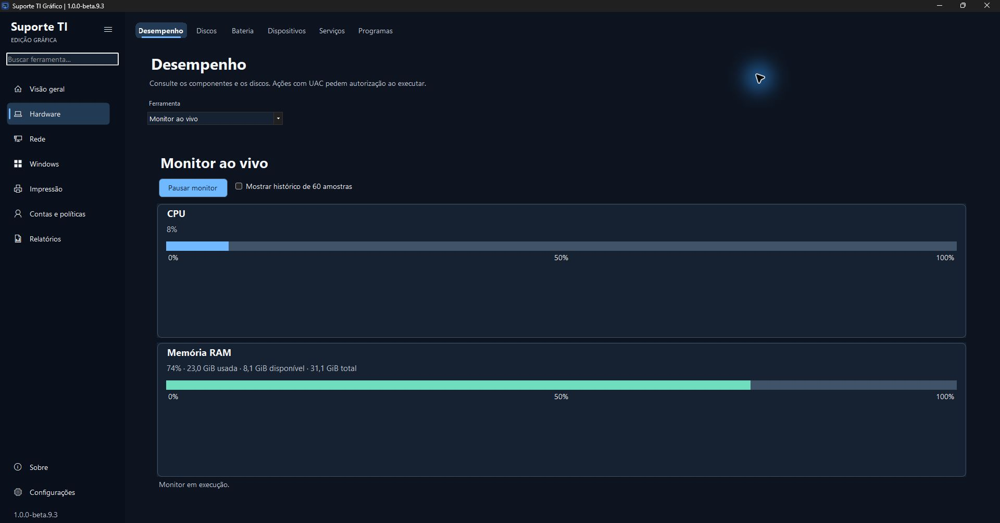
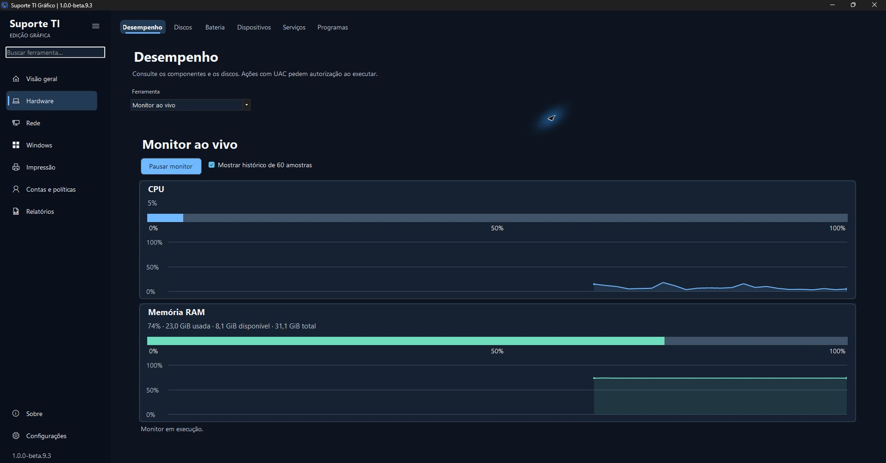
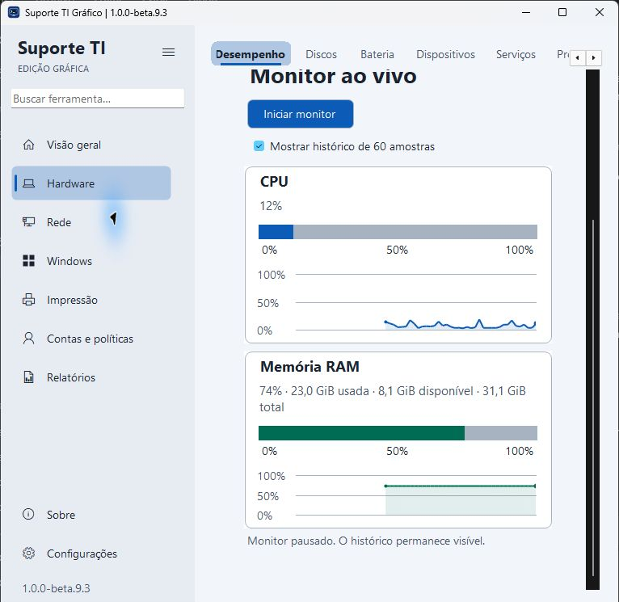
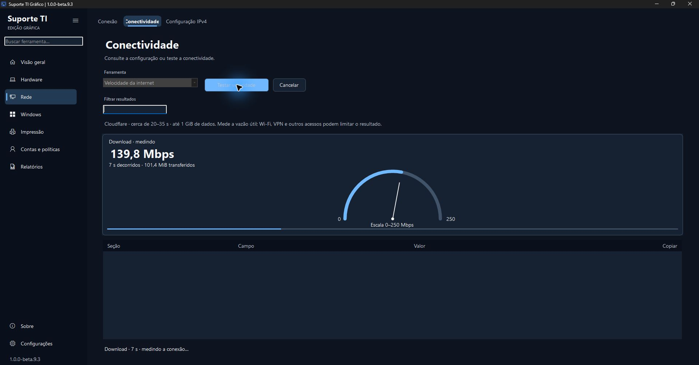
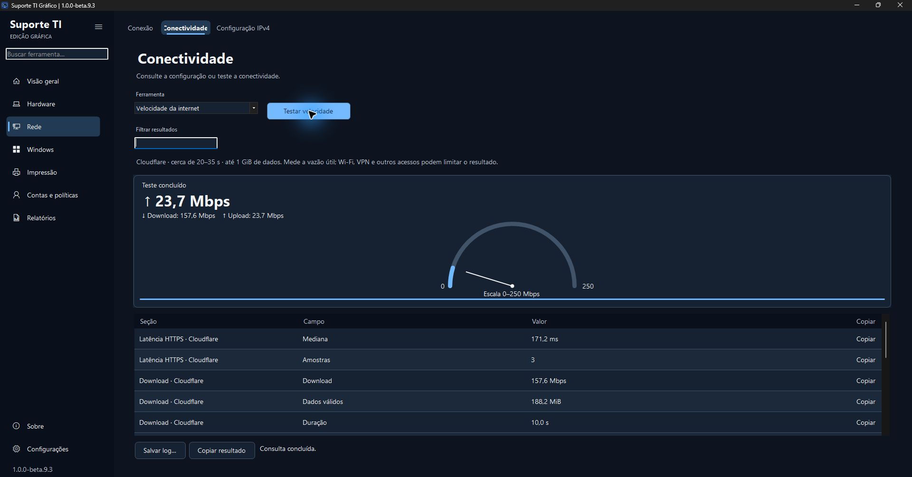
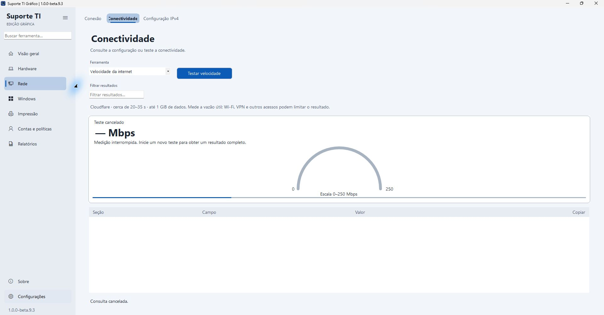
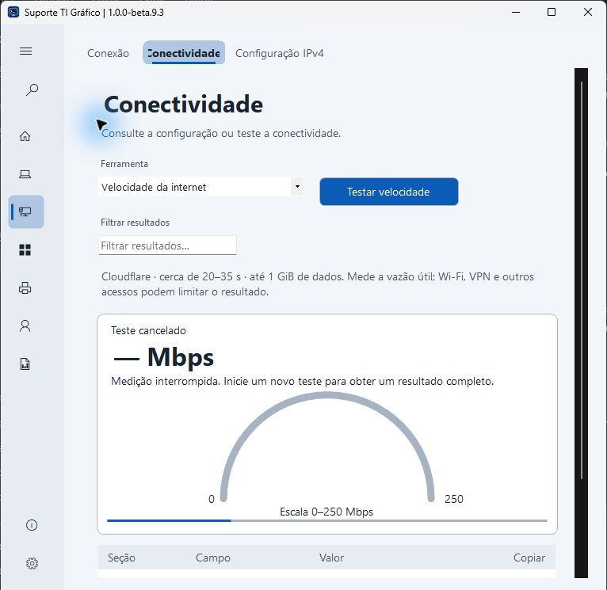

# Suporte TI Gráfico 1.0.0-beta.9.3

Segunda etapa do dashboard de monitoramento, sobre a estrutura adaptável da beta.9.2.

- Barras horizontais reais de CPU/RAM a cada segundo, em escala fixa de 0–100%, com memória usada, disponível e total.
- Histórico opcional das últimas 60 amostras; pausar preserva as leituras e iniciar novamente limpa o histórico. A rolagem reserva espaço para os cartões expandidos.
- Velocímetro da vazão média acumulada de download/upload, com escala em Mbps crescente e explícita. Progresso da fase separado da taxa; cancelamento e leituras indisponíveis não inventam resultados.
- Resultados finais, logs, cópia, limites de tráfego e motor HTTPS preservados. A redistribuição dos menus é a próxima etapa; PowerShell 7 continua previsto para avaliação na beta.10.

São capturas da versão executada, com apenas o rodapé de identificação da estação recortado. Valores são exemplos de uma sessão real e não representam desempenho garantido.

Validação: **159 testes automatizados**, incluindo CIM real e cenários isolados de velocidade, e **13 simulações de intervenção**. ZIP extraído verificado; inspeção local de barras, histórico, pausa ao navegar, rolagem, medição completa, cancelamento e temas Claro/Sistema escuro. [Evidências e limites](../Suporte%20TI%20Grafico/Testes/RESULTADO.md).

A versão permanece prévia sem assinatura Authenticode. Windows 10, laboratório administrativo, VM limpa, DPI/alto contraste, janela mínima exata e a repetição completa do clipboard seguem na matriz de homologação. A geração local registrou NU1900 por indisponibilidade da auditoria NuGet mesmo fora da sandbox; o aviso não foi suprimido.

Baixe o ZIP portátil e o arquivo SHA-256 da mesma release, confira a integridade e extraia todo o conteúdo em uma pasta nova. Mantenha o executável, Modulos e Documentacao juntos. A beta.9.2 continua disponível para comparação e retorno.
