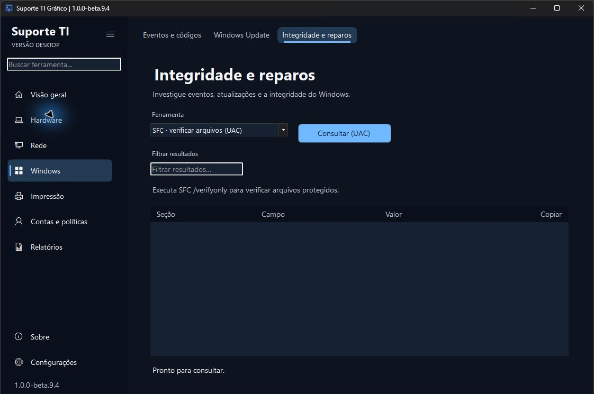
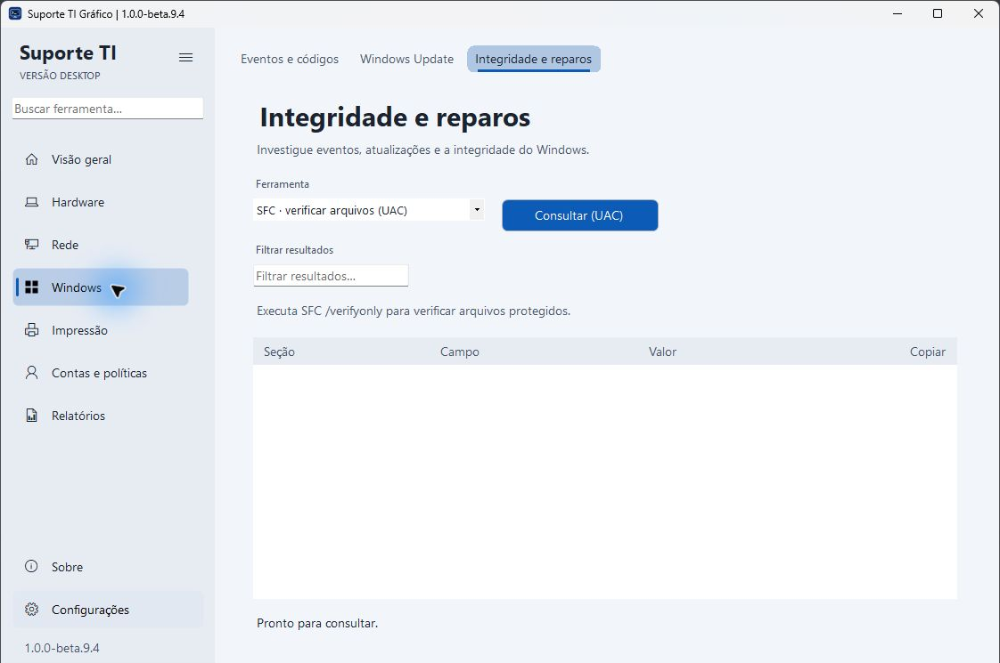

# Suporte TI Gráfico 1.0.0-beta.9.4

Primeira entrega pequena após a aprovação da direção visual Linear + iStat + Raycast: legibilidade das guias e identidade Desktop.

- Corrigido o recorte das letras em guias selecionadas, incluindo Windows → Integridade e reparos. A fonte usada no desenho corresponde à medição do TabControl; a seleção permanece identificada pelo fundo e pela linha inferior. A área interna deixa espaço para o texto completo.
- A identificação lateral passa de EDIÇÃO GRÁFICA para VERSÃO DESKTOP.
- A direção aprovada está registrada no planejamento. A composição Linear, o monitoramento iStat e a busca em camadas Raycast serão as entregas seguintes, uma de cada vez.

Capturas do pacote real desta versão, com recorte somente do rodapé que identifica a estação. A aparência da barra de título ativa/inativa pode variar conforme o Windows; sua modernização permanece no planejamento.

Validação local: 159 testes automatizados com CIM real e 13 simulações de intervenção aprovados. A inspeção da janela conferiu o texto completo selecionado e não selecionado, identidade e temas Claro/Sistema resolvido como Escuro. Não foram executados reparos reais. [Resultados e limites](../Suporte%20TI%20Grafico/Testes/RESULTADO.md).

A prévia continua sem assinatura Authenticode. Janela estreita, navegação completa por teclado, matriz DPI, alto contraste, Windows 10 e laboratório administrativo seguem pendentes de homologação dirigida. O publicador local registrou NU1900 ao consultar a auditoria NuGet; o aviso não foi suprimido.

Baixe o ZIP e o SHA-256 da mesma release, confira a integridade e extraia o conteúdo completo em uma pasta nova. A beta.9.3 permanece disponível para comparação e retorno.

## Fechamento da publicação · 11 de novembro de 2026

[Release publicada](https://github.com/gustavo-brandao/SuporteTI-Desktop/releases/tag/v1.0.0-beta.9.4) após integrar o [PR #4](https://github.com/gustavo-brandao/SuporteTI-Desktop/pull/4). A tentativa inicial do CI permaneceu na fila sem criar jobs; foram solicitados cancelamento comum e forçado, sem conclusão imediata. Uma [execução manual completa](https://github.com/gustavo-brandao/SuporteTI-Desktop/actions/runs/43093939216) aprovou testes, simulações, geração, verificação do pacote e envio do artefato no commit exato da entrega. A árvore de arquivos integrada na main é idêntica à revisão validada.

O README e a imagem de Integridade e reparos no GitHub conferiram com os arquivos locais por hash Git. O ZIP remoto tem 50.100.177 bytes e digest SHA-256 `ac6755e01b4c8d225eb60c7ee75b307ccbacbb59fecef7bab42c4eee79ca523d`, igual ao pacote local inspecionado.

No momento da publicação, o [CI automático adicional da main](https://github.com/gustavo-brandao/SuporteTI-Desktop/actions/runs/43094778781) havia aprovado testes, simulações, compilação e verificação do pacote extraído, mas continuava no envio ao armazenamento de artefatos do Actions. Esse envio adicional foi registrado separadamente da validação completa já aprovada e do ZIP da release já disponível. Não foi declarado sucesso final dessa execução adicional.
