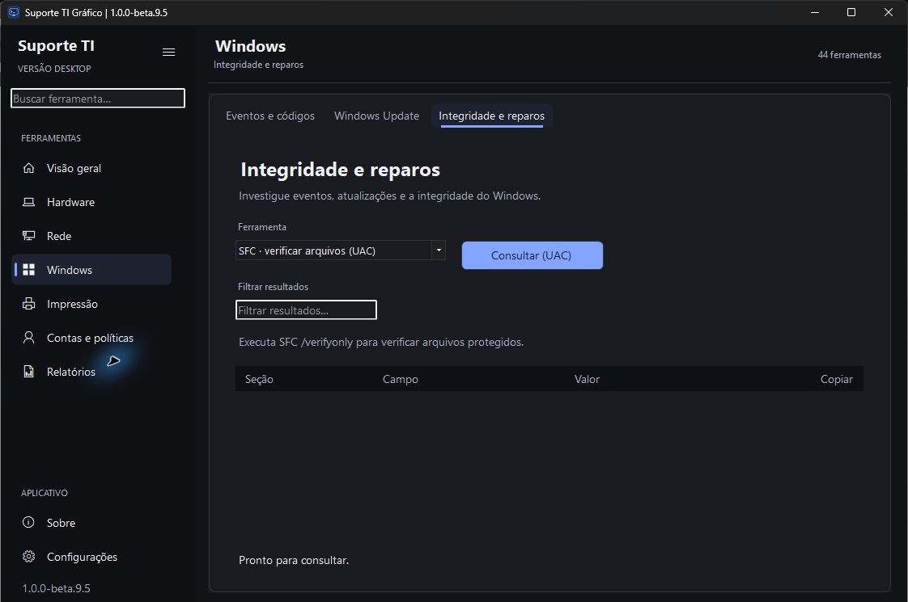
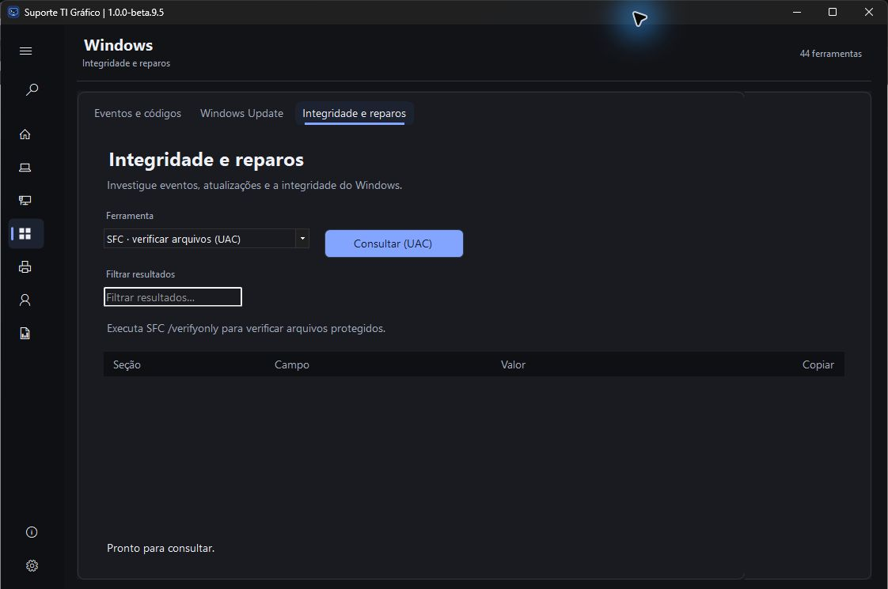
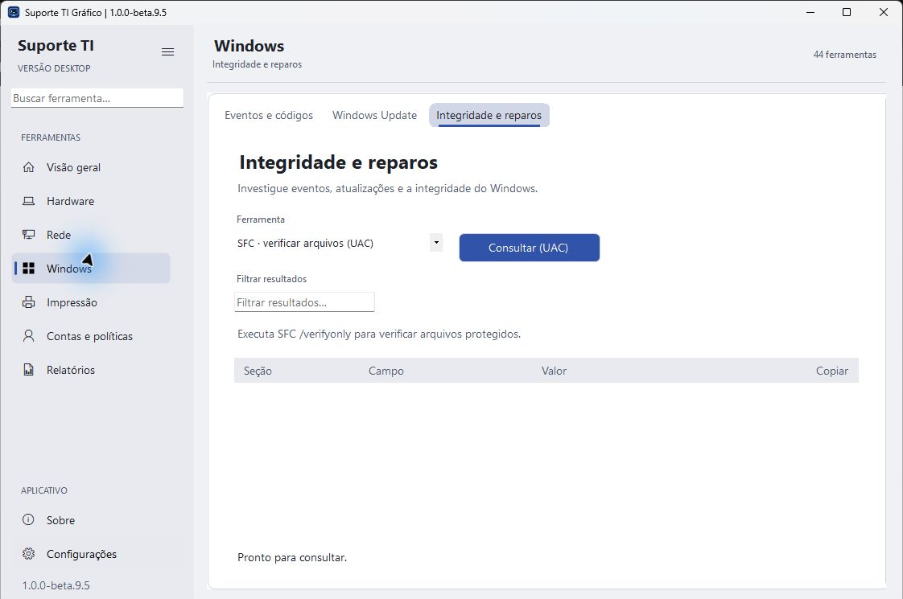

# Suporte TI Gráfico 1.0.0-beta.9.5

Etapa **2.1 — estrutura da área de trabalho**, seguindo a direção visual aprovada com inspiração no Linear.

- Cabeçalho contextual com grupo, área e contagem do catálogo.
- Navegação organizada em Ferramentas e Aplicativo, com títulos e espaçamento mais compactos.
- Conteúdo em superfície própria, guias integradas e paletas neutras com destaque azul.
- As 44 operações e os formulários continuam disponíveis. O texto de Integridade e reparos permanece completo.

Capturas do pacote real, com recorte somente do rodapé que identifica a estação.

Validação local: **159 testes automatizados com CIM real e 13 simulações de intervenção aprovados**. Consulta de sistema real concluída, cabeçalho, retorno de Sobre, navegação recolhida e temas Claro/Sistema conferidos. [Resultados e limites](../Suporte%20TI%20Grafico/Testes/RESULTADO.md).

A etapa 2 continua com **2.2 — barra de título e moldura**, incluindo arraste, Snap, maximização, restauração, redimensionamento e DPI. Depois seguem monitoramento, busca, movimento e homologação. [Planejamento](PLANEJAMENTO.md).

O pacote permanece beta e sem Authenticode. O publicador local registrou NU1900 na auditoria NuGet, sem suprimir o aviso. Os aceites de laboratório e acessibilidade continuam registrados na matriz. Extraia o ZIP completo em uma pasta nova e confira o SHA-256; a beta.9.4 permanece disponível para retorno.

## Estado da publicação · 11 de novembro de 2026

Implementação enviada no [PR #5](https://github.com/gustavo-brandao/SuporteTI-Desktop/pull/5), revisão `27e5aa757a045c1a89c785dc338071eef4266d5f`. README e três imagens na branch do GitHub conferidos por hash Git com os arquivos locais. O ZIP do rascunho de release tem **50.101.053 bytes** e digest remoto `d024e1d2c083dd1391708f500fa94986074effe69e588a176cca47cda9069b00`, igual ao pacote local validado.

O [CI do PR](https://github.com/gustavo-brandao/SuporteTI-Desktop/actions/runs/43097760696) permaneceu na fila sem jobs. A [execução manual da mesma revisão](https://github.com/gustavo-brandao/SuporteTI-Desktop/actions/runs/43097961461) terminou a primeira tentativa com `startup_failure`, sem jobs ou logs; uma segunda tentativa foi iniciada e estava na fila no último acompanhamento. Não se declara aprovação do CI. A integração na main e a publicação da release aguardam esse aceite; o ZIP local já está disponível para avaliação.

Próximas entregas: **2.2** barra de título e moldura; **3** refinamento do monitoramento inspirado no iStat; **4** busca em camadas inspirada no Raycast; **5** animações e transições; **6** homologação visual e funcional; **7** avaliação do PowerShell 7 na beta.10; **8** preparação da versão estável. Cada entrega mantém verificação, documentação, imagens pertinentes e ZIP próprios.
