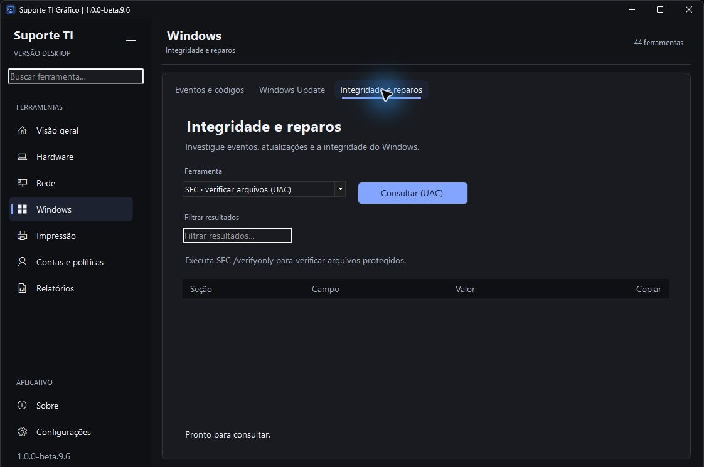
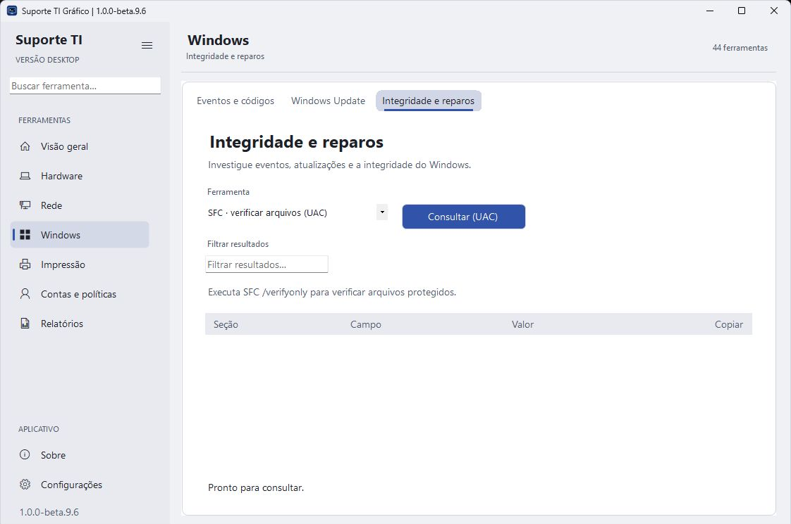
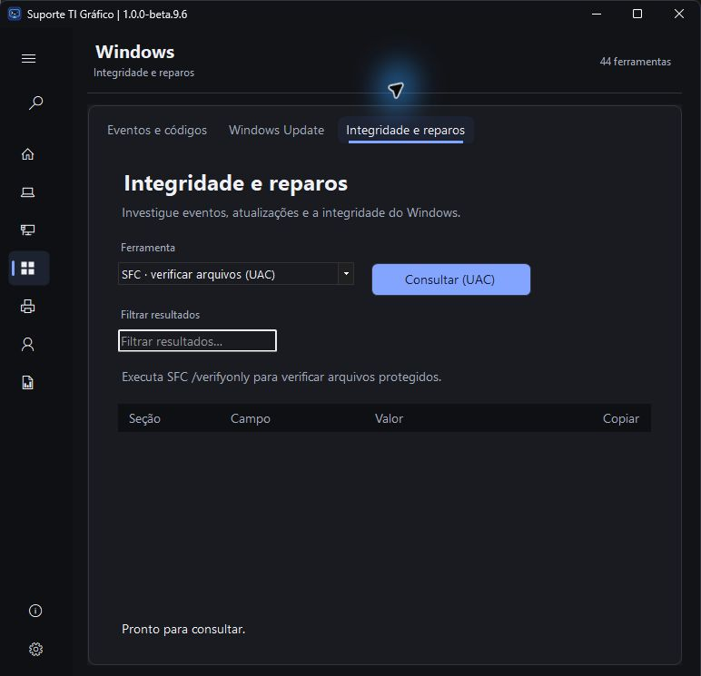

# Suporte TI Gráfico 1.0.0-beta.9.6

Conclui a implementação da etapa **2.2 — barra de título e moldura** e inclui a estrutura da etapa 2.1.

- Título integrado à paleta e borda discreta no Windows 11; texto e borda acompanham ativação e desativação.
- Cores reaplicadas em recriação da janela, tema e DPI; alto contraste devolve o acabamento ao sistema.
- Arraste, tamanho, Snap, menu e controles continuam nativos. Windows 10 conserva o acabamento disponível no sistema.
- As 44 operações continuam disponíveis; monitoramento iStat, busca Raycast e novas transições serão entregas próprias.

Capturas reais, com recorte somente do rodapé que identifica a estação. Validação local: 159 testes com CIM e 13 simulações aprovados; maximizar/restaurar, duplo clique, arraste, menu, redução de largura, temas e reabertura conferidos. Snap, mudanças reais de DPI, alto contraste e Windows 10 seguem na matriz de laboratório. [Resultados e limites](../Suporte%20TI%20Grafico/Testes/RESULTADO.md).

A beta.9.5 ficou como rascunho da etapa 2.1; esta prévia reúne as duas subdivisões. A beta.9.4 pública permanece disponível para retorno. Extraia o ZIP completo em uma pasta nova e confira o SHA-256. A prévia continua sem Authenticode.

Próximas etapas: **3** monitoramento iStat; **4** busca Raycast; **5** animações e transições; **6** homologação visual e funcional; **7** avaliação do PowerShell 7; **8** preparação da versão estável. [Planejamento](PLANEJAMENTO.md).
