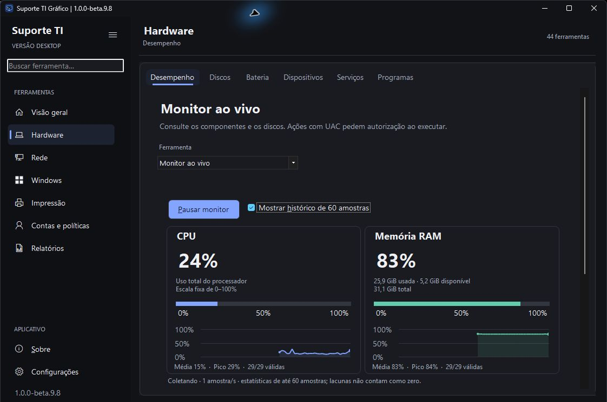
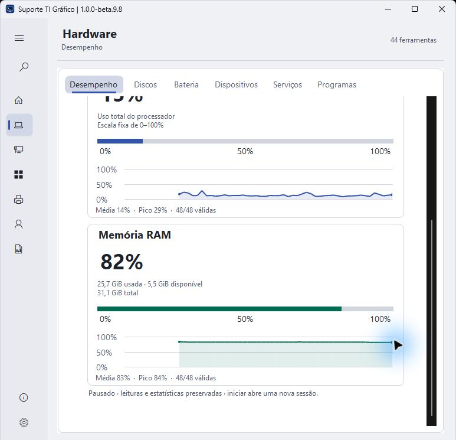
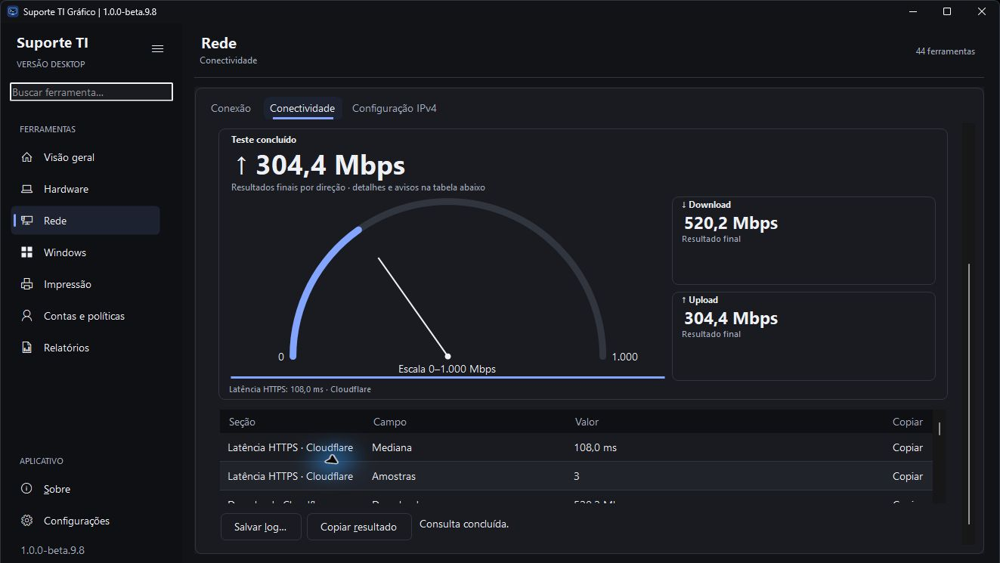
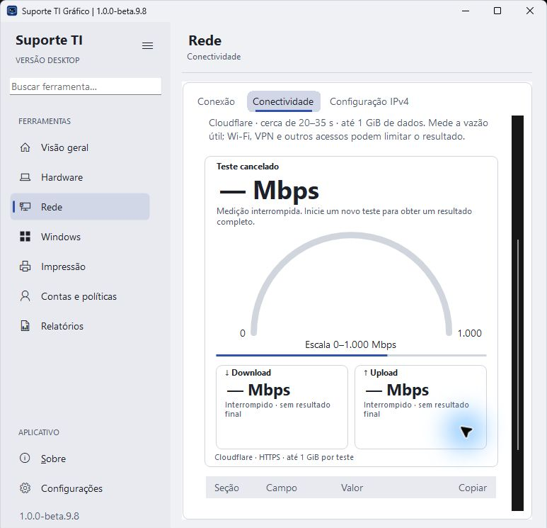

# Suporte TI Gráfico 1.0.0-beta.9.8

Entrega integrada de **3.1 — monitor CPU/RAM** e **3.2 — velocímetro e estados**, revisadas antes da publicação conjunta.

- CPU/RAM em cartões adaptáveis, porcentagens em destaque, memória usada/disponível/total e histórico aberto por padrão.
- Média/pico das leituras válidas da janela de até 60 posições; zero real conta e lacunas não são tratadas como zero. Pausa preserva; iniciar limpa a sessão.
- Taxa provisória separada dos resultados finais de download/upload e latência HTTPS. Resumos ao lado do arco ou abaixo dele em largura reduzida.
- Cancelamento remove agulha e taxa provisória; resultado parcial conserva a direção válida. Atualizações tardias são ignoradas. Nova execução limpa resultados e escala anteriores.
- Ajustes de altura e redesenho dos cartões preservam escalas e bordas ao recolher histórico ou redimensionar. Motor, limites, servidor e relatórios preservados; novas animações ficam na etapa 5.

Capturas reais da prévia integrada, com recorte somente do rodapé que identifica a estação. **173 testes com CIM real e 13 simulações aprovados**; compilação sem avisos. Inspeção local de coleta, 60 amostras, histórico, pausa/reinício, troca de ferramenta, medição e cancelamento reais, janelas ampla/estreita e temas Claro/Sistema. O último ajuste de redesenho das bordas foi compilado e repetido visualmente. [Resultados e limites](../Suporte%20TI%20Grafico/Testes/RESULTADO.md).

A beta.9.7 ficou como revisão intermediária, sem release pública. A beta.9.6 permanece disponível para retorno. Extraia o ZIP completo em uma pasta nova e compare o SHA-256. A prévia segue sem Authenticode; DPI/alto contraste, Windows 10 e laboratório administrativo continuam na matriz de homologação.

Próximas etapas: **4** busca em camadas Raycast; **5** animações e transições; **6** homologação visual e funcional; **7** avaliação do PowerShell 7; **8** preparação da versão estável. [Planejamento](PLANEJAMENTO.md).

## Fechamento da publicação

[Release pública com ZIP e SHA-256](https://github.com/gustavo-brandao/SuporteTI-Desktop/releases/tag/v1.0.0-beta.9.8), após integrar o [PR #6](https://github.com/gustavo-brandao/SuporteTI-Desktop/pull/6). O [CI completo](https://github.com/gustavo-brandao/SuporteTI-Desktop/actions/runs/43147347468) aprovou testes, simulações, publicação, verificação do pacote e envio do artefato na revisão `c4ea7f555eed36395dee83397a32064e79410259`. A integração `5b98ffcdf4213445363ddcf0bd594923313766d3` conserva a árvore validada `4f86e2c4047342ef5ed13baaee649a9b7b0305e3`.

README e quatro capturas no GitHub conferidos por hash Git com os arquivos locais. O ZIP publicado tem **50.108.922 bytes**, digest remoto SHA-256 `ff3ed08905f92260cdb51560679d0ce5e05a13b6e76d87304b049650b5f65485`, igual ao pacote local. Os 24 arquivos de programa conferem com a última compilação inspecionada; manual, 45 links locais e quatro PNGs verificados. O ZIP definitivo passou em integridade, estrutura de três itens e consultas reais: sistema concluído e discos com leitura parcial válida.

As duas subdivisões foram encerradas na mesma entrega. As pendências da matriz de laboratório permanecem na etapa 6; o CI e a inspeção local não equivalem a homologação de todos os ambientes.
