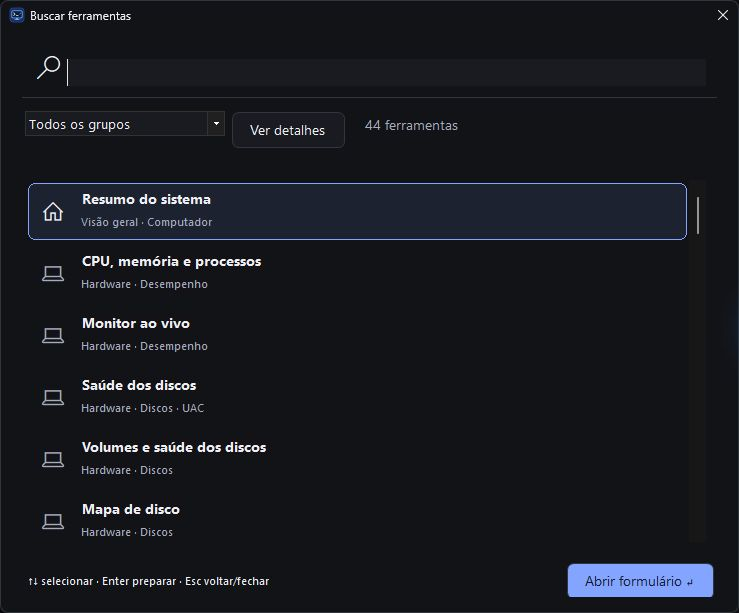
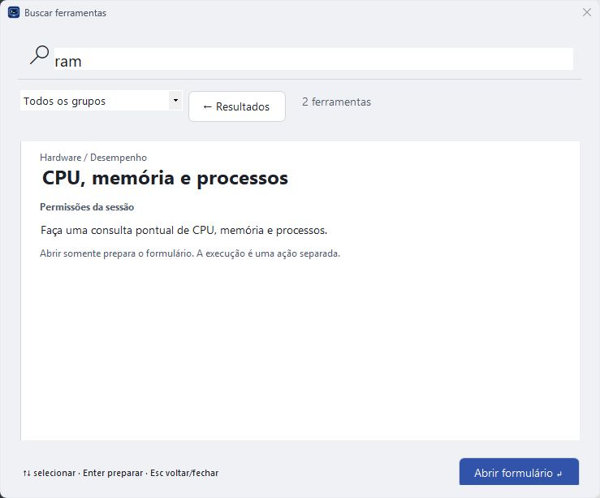
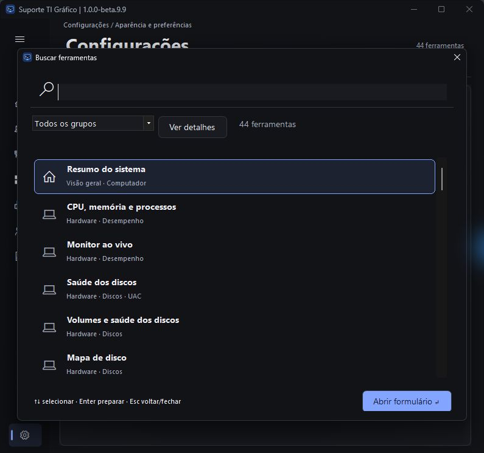
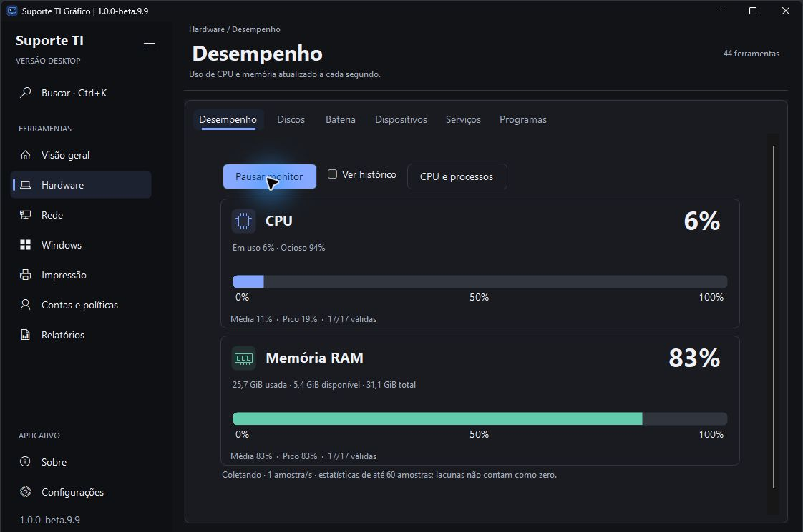

# Suporte TI Gráfico 1.0.0-beta.9.9

Etapa **4.1 busca em camadas**, **4.2 revisão dirigida de fidelidade visual** e **4.3 parada do SFC**.

- Paleta central com filtro por grupo, prévia de finalidade/permissões/impacto e acesso às 44 operações. Enter prepara; Esc retorna. Layout em camadas na janela estreita.
- Título principal consolidado, monitor direto em Hardware, CPU/RAM empilhados com ícones e barras mais presentes. Histórico inicialmente recolhido; CPU e processos preserva consulta pontual.
- SFC sem reparo permite parar. O reparo mostra o aviso da recomendação Microsoft e oferece Encerrar mesmo assim após confirmação, com Continuar aguardando como padrão. O aplicativo aguarda término e limpeza; saída parcial avisa que a verificação/reparo ficou incompleto. Não desfaz alterações já realizadas.
- Restrição aos dois modos SFC, pelo canal elevado validado; não encerra outros processos ou serviços de manutenção.

[Comparação visual](REVISAO-VISUAL-beta9.9.md) · [Resultados e limites](../Suporte%20TI%20Grafico/Testes/RESULTADO.md) · [Homologação](../Suporte%20TI%20Grafico/Testes/HOMOLOGACAO.md).

**181 testes automatizados com CIM real, 14 simulações de intervenção e 5 testes de parada aprovados**, incluindo os testes de parada no Windows PowerShell 5.1. Compilação sem avisos. Monitor e busca inspecionados; centralização corrigida e repetida em janela de aproximadamente 800 px. A interrupção de reparo real e o fluxo completo elevado com conta distinta ainda exigem laboratório. Publicação em preparação. A beta.9.8 permanece disponível para retorno. Esta prévia continua sem Authenticode; laboratório de reparo real/conta distinta, Windows 10, DPI e alto contraste permanece na matriz.

Próximas etapas: **5** animações/transições e continuidade da composição dos menus; **6** homologação visual/funcional; **7** avaliação de PowerShell 7; **8** preparação da versão estável.

ZIP definitivo: **50.122.250 bytes**, SHA-256 `01b80a8901946a114c504d1d8fe3ede419c02e0f11df3f95366b997d2f322322`. Os 24 arquivos de programa são idênticos à compilação inspecionada. Manual e homologação do pacote, 51 links locais e quatro PNGs conferidos. Integridade, estrutura e consultas reais do pacote final aprovadas; leitura de discos parcial válida.
