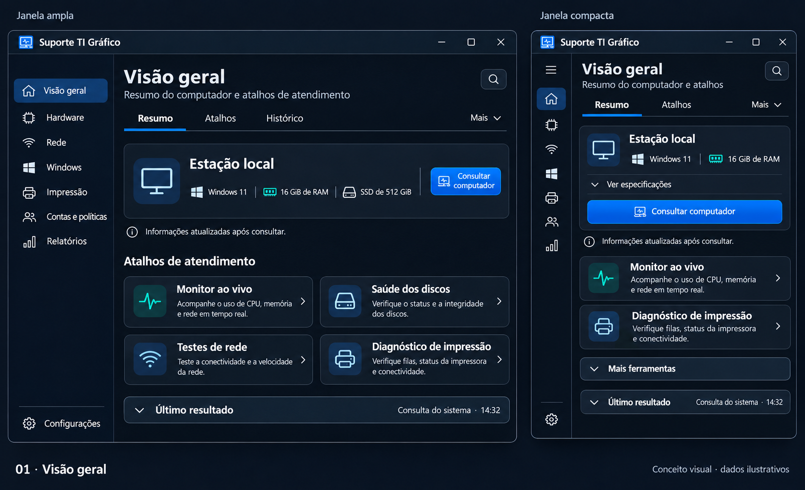
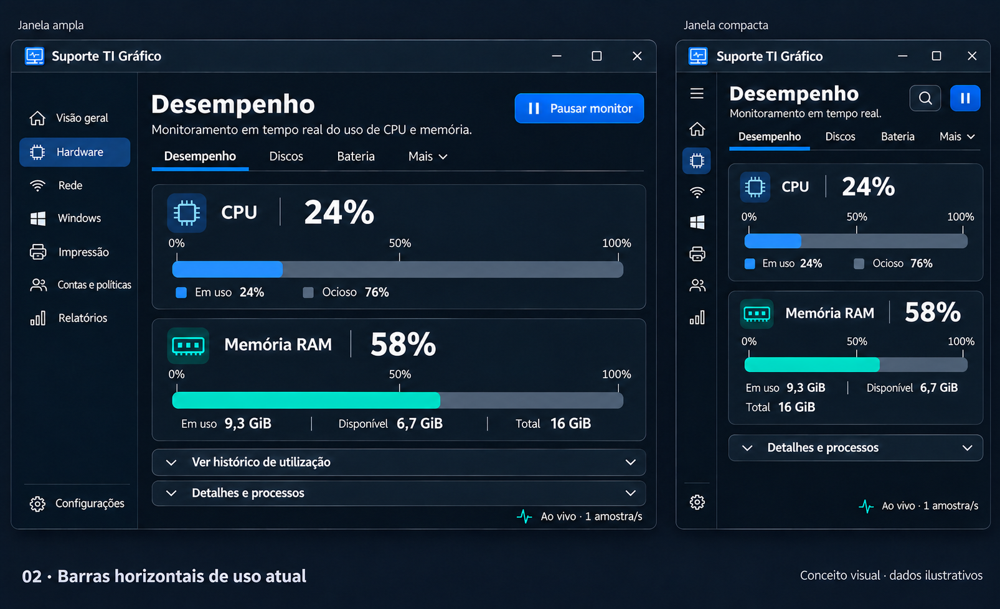
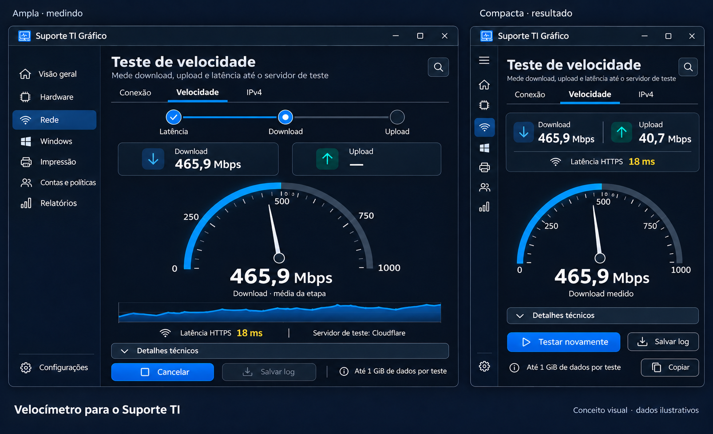
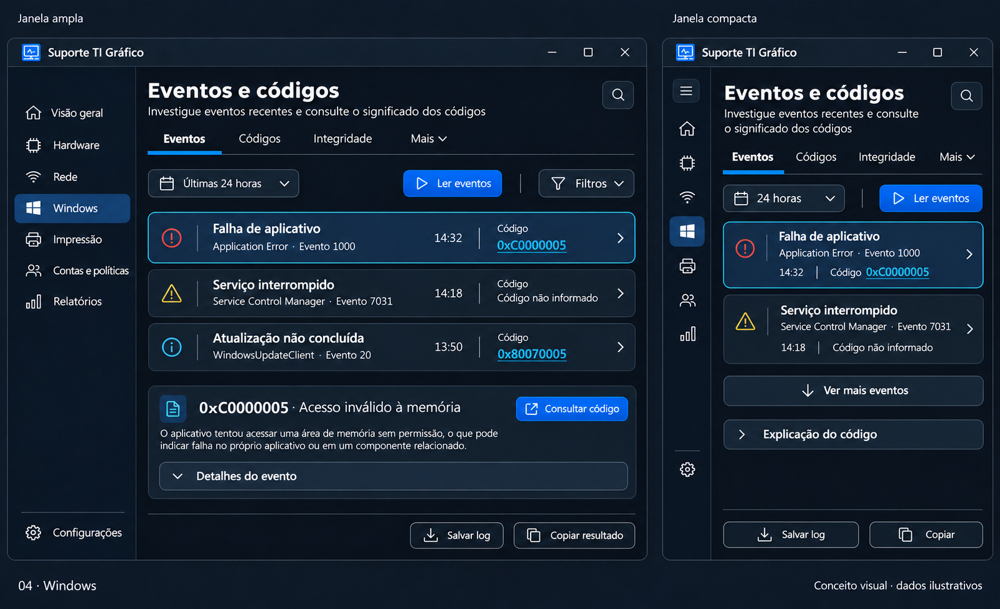
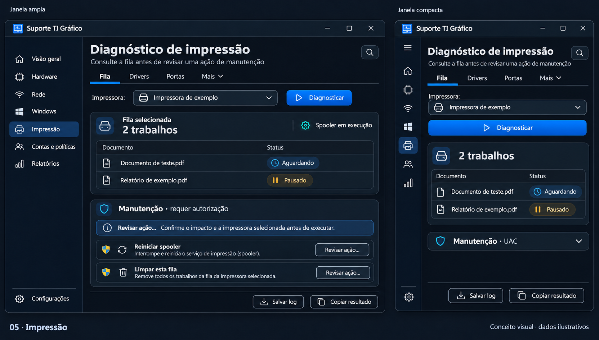

# Dashboard de monitoramento: conjunto consolidado para avaliação

**10 de novembro de 2026 · edição pública genérica.**

## Entrega dos componentes · beta.9.3

As barras de CPU/RAM com histórico opcional e o velocímetro foram implementados na beta.9.3. As [capturas reais e os limites da validação](../../../RELEASE-beta9.3.md) registram esta etapa. Os cinco layouts abaixo continuam sendo referências conceituais para a reorganização seguinte dos menus.

## O que já foi aprovado e o que está em avaliação

- **Aprovado:** estilo Dashboard de monitoramento, com superfícies sóbrias, azul e verde-água.
- **Aprovado:** opção 2 de CPU/RAM, com barras horizontais e leituras reais atualizadas em tempo real. A coleta atual por segundo é a referência para implementar essa atualização.
- **Aprovado:** velocímetro para internet, inspirado na composição do Speedtest, preservando a identidade e o motor de medição do Suporte TI.
- **Exigido:** adaptação à largura útil da janela, legibilidade e quantidade controlada de informação nas telas menores.
- **Para avaliação nesta galeria:** disposição e conteúdo dos cinco menus, prioridades, resumos e informações expansíveis.

Os cinco exemplos abaixo consolidam imagens já geradas com **imagegen**, escolhendo as variantes aprovadas. São propostas com dados ilustrativos, não capturas de uma versão implementada. A reunião das imagens não modifica o executável, os coletores, a versão ou as capturas reais do README de distribuição.

Os [prompts dos menus](../menus-responsivos/prompts.json) e os [prompts das barras e do velocímetro](../hardware-barras/prompts.json) permanecem disponíveis. Algumas legendas de mockup são sugestões de navegação e precisam ser conferidas contra as ferramentas existentes.

**Ajustes identificados na revisão das imagens:** o atalho “Monitor ao vivo” da primeira imagem deve dizer CPU e memória, pois o monitor atual não coleta rede. “Histórico”, nessa tela, deve ser substituído por “Último resultado” enquanto não existir histórico persistente. Na imagem de Hardware compacta, o acesso ao histórico deve continuar disponível junto a detalhes, mesmo recolhido. “Drivers” e “Portas”, em Impressão, são possibilidades de organização, não novas consultas já existentes; usar detalhes do diagnóstico quando houver dados, sem criar abas vazias. O aviso do reinício do spooler deve mencionar todas as filas locais. As imagens são referências de composição; o texto corrigido deste documento orienta a implementação.

## 1. Visão geral

**Objetivo:** começar um atendimento e localizar uma ferramenta rapidamente.

Na janela ampla, mostrar identificação do computador, resumo do sistema e quatro atalhos. Na compacta, priorizar a consulta principal, dois atalhos e especificações expansíveis. Usar o último resultado da sessão com horário; não inventar pontuação geral de saúde ou histórico persistente que o aplicativo ainda não mantém.

**Resumo sugerido:** “Consulte o computador e abra as ferramentas de atendimento.” É suficiente uma frase; não colocar descrições sob todos os itens da navegação lateral.

## 2. Hardware

**Objetivo:** observar recursos e investigar componentes.

A tela padrão de desempenho usa as barras horizontais aprovadas. Os percentuais e a memória usada/disponível/total permanecem visíveis na janela compacta. Histórico e processos ficam recolhidos, mas continuam acessíveis. A escala dos percentuais deve ser fixa em 0–100%, e a leitura numérica deve ser real; animação não acrescenta amostras.

**Resumo sugerido:** “Uso de CPU e memória atualizado a cada segundo.” Não repetir grandes títulos como Hardware → Desempenho e Monitor ao vivo em blocos separados. O estado deve identificar execução, pausa, primeira amostra ou indisponibilidade.

As outras abas de Hardware têm tarefas próprias: Discos separa saúde, ocupação, mapa e verificações; Bateria conserva os indicadores disponíveis; Dispositivos, Serviços e Programas usam listas e detalhes. Não misturar todos esses indicadores na tela inicial de desempenho.

## 3. Rede

**Objetivo:** consultar conexão, medir internet ou revisar uma configuração.

O velocímetro mostra a taxa da etapa atual, com número e unidade grandes. Download e upload permanecem igualmente identificados. Na janela compacta, manter medidor, resultados essenciais e comandos; informações de método ficam expansíveis. A imagem ampla representa medição e a compacta representa resultado, para avaliar os dois estados.

**Resumo sugerido:** “Mede download, upload e latência até o servidor de teste.” Manter o limite de dados e o servidor visíveis no contexto adequado. A indicação é latência HTTPS; não renomeá-la como ping ICMP nem mostrar jitter/perda de pacotes que não foram medidos. A inspiração na Ookla é visual; o motor atual usa Cloudflare.

IPv4 deve continuar uma tarefa separada: adaptador, modo DHCP/manual, validação dos campos e revisão antes de alterar a conexão. Testes de rede não executam correção automaticamente.

## 4. Windows

**Objetivo:** entender eventos, pesquisar códigos e revisar atualizações ou integridade.

Na janela ampla, lista de eventos e explicação contextual. Na compacta, menos cartões por vez e explicação expansível. Ler eventos, período, salvar log e copiar continuam acessíveis. Uma lista com rolagem ou paginação precisa indicar a quantidade exibida e manter acesso aos demais registros.

**Resumo sugerido:** “Investigue eventos recentes e consulte o significado dos códigos.” Destacar origem, ID do evento, horário e código; ID do evento não deve ser tratado automaticamente como código de erro Win32. Clicar no código continua preenchendo e executando sua pesquisa automática.

As tarefas SFC/DISM/CHKDSK precisam de explicação mais específica e separação explícita entre verificar e reparar. Os detalhes completos do evento ou do comando continuam acessíveis e presentes no relatório, ainda que recolhidos visualmente.

## 5. Impressão

**Objetivo:** diagnosticar antes de escolher uma manutenção.

Mostrar impressora/fila, trabalhos e diagnóstico. Separar manutenção do conteúdo principal, com revisão e indicação de UAC. Na compacta, recolher manutenção e manter diagnóstico e log visíveis.

**Resumo sugerido:** “Consulte a fila antes de revisar uma ação de manutenção.” A imagem distingue reiniciar spooler e limpar uma fila. A redação final precisa deixar claro que reiniciar o serviço pode afetar todas as filas locais, enquanto limpar trabalhos deve ficar restrito à fila local escolhida.

## Regras de adaptação propostas

Os pontos de quebra abaixo são candidatos em pixels efetivos da área da janela, não uma declaração de suporte já testado. DPI e moldura reduzem a área útil; o protótipo deve ajustar os limites com dados reais.

| Largura disponível | Organização candidata |
| --- | --- |
| Ampla, aproximadamente 1.200 epx ou mais | Navegação com nomes, até duas colunas de conteúdo relacionado e detalhes conforme a tarefa |
| Intermediária, aproximadamente 900–1.199 epx | Navegação recolhível, menos colunas e controles secundários agrupados |
| Compacta, abaixo de aproximadamente 900 epx | Uma coluna, navegação recolhida ou sobreposta, poucos cartões essenciais e detalhes expansíveis |

Regras comuns:

1. Não reduzir a fonte para encaixar toda a informação. Reorganizar, empilhar e recolher detalhes.
2. Não ocultar ação principal, cancelamento aplicável, destino de manutenção, avisos de impacto ou acesso a salvar logs.
3. Usar uma linha estável de guias, com rolagem ou Mais, preservando a sequência e o acesso por teclado.
4. Na navegação recolhida, oferecer botão de expansão, nome acessível e tooltip; ícones precisam manter rótulos para leitores de tela.
5. Limitar os controles de escolha ao contexto da tarefa. Não criar simultaneamente submenu, abas, seletor genérico e outra linha de modos para a mesma decisão.
6. Não forçar uma grande tabela técnica junto a um grande gráfico. O resultado completo pode ficar em detalhes expansíveis.
7. Permitir rolagem vertical quando necessária, preservando alturas legíveis dos cartões e sem recortar mensagens ou botões.
8. Recolher informação não exclui dados do log, da cópia completa ou da consulta.

## Política de resumos e ajuda

Há três tratamentos, definidos pela necessidade de entendimento e pelo efeito da ação:

- **Rótulo suficiente:** comandos conhecidos como Salvar log, Copiar, Atualizar e Pausar. Usar tooltip para atalho/formato quando útil, sem uma frase fixa repetindo o rótulo.
- **Resumo curto:** uma frase junto à tarefa para definir o que será consultado, o período ou a limitação. Explicações longas e termos avançados ficam em Entender esta operação/Detalhes.
- **Impacto sempre visível:** informações necessárias antes de alterar, excluir, interromper serviços, trocar IP, reparar volume ou configurar login. Não esconder esses avisos em tooltips ou acordeões fechados.

Não colocar ajuda expansível em toda palavra. CPU, RAM e percentuais já têm rótulos conhecidos; a explicação útil é frequência de leitura, unidade, origem e significado de indisponível. Perguntas frequentes podem ficar numa ajuda contextual, sem tomar a tela principal.

## Organização e redução de escolhas

Manter os sete grupos conhecidos e simplificar dentro deles, sem acrescentar níveis de navegação redundantes:

| Grupo | Organização proposta | Simplificação |
| --- | --- | --- |
| Visão geral | Computador, atalhos e último resultado | Evitar transformar a abertura em painel com todos os diagnósticos executados automaticamente. |
| Hardware | Desempenho, Discos, Bateria e demais ferramentas em Mais | Monitor contínuo como tarefa principal de Desempenho; consulta pontual e processos em detalhes claramente identificados. Em Discos, distinguir Saúde, Espaço e Mapa. |
| Rede | Conexão, Testes e Configuração IPv4 | Dentro de Testes, escolher Ping ou Velocidade sem repetir um segundo seletor com as mesmas escolhas. DHCP/manual continuam modos de um único formulário. |
| Windows | Eventos e códigos, Windows Update e Integridade | Unificar o caminho visual de falhas/eventos com filtros de leitura; manter verificação e reparo identificados separadamente. |
| Impressão | Diagnóstico da fila e manutenção contextual | Escolher a fila uma vez e preservar esse alvo ao revisar uma limpeza. Reiniciar spooler conserva aviso de efeito global. |
| Contas e políticas | Políticas de grupo, Perfis e Login automático | Preservar Escopo e Ação nas GPO; não voltar a criar uma entrada principal para cada combinação. |
| Relatórios | Último resultado e exportação de eventos | Salvar/copiar no contexto do resultado, sem obrigar a navegar até Relatórios. |

Renomear a consulta “Volumes e saúde dos discos” para algo como **Volumes e espaço**, quando os indicadores completos de saúde estiverem na tarefa específica, para reduzir a confusão entre ocupação e falha física. Não usar “Administrativo” como destino de tarefas: UAC é uma característica da operação, não uma categoria útil para encontrar discos ou impressão.

A automação deve preencher contexto e reduzir decisões repetidas: aproveitar a fila/adaptador já escolhido, manter parâmetros válidos ao voltar e pesquisar um código clicado. Não disparar reparos, limpeza ou troca de IP como consequência de uma consulta. A lista de 44 operações continua sendo a referência de paridade, mesmo com menos escolhas simultâneas na tela.

## Matriz das 44 operações

O catálogo atual é a referência. Os nomes abaixo são rótulos e descrições candidatos, sem mudar a operação ou sua permissão. A indicação de UAC deve vir da regra efetiva do aplicativo.

| Menu e operação | Tratamento | Resumo ou informação necessária |
| --- | --- | --- |
| Visão geral · `sistema` | Curto | “Consulta informações do computador e do Windows.” Mostrar horário da leitura. |
| Hardware · `desempenho` | Curto | “Consulta CPU, memória e processos.” Não confundir fotografia da consulta com monitor contínuo. |
| Hardware · `monitor` | Curto e estado | “Atualização a cada segundo.” Mostrar execução/pausa e indisponibilidade. |
| Hardware · `diskhealth` | Curto + limitação | “Consulta indicadores de saúde dos discos.” Explicar acesso administrativo e SMART parcial/ausente. |
| Hardware · `discos` | Curto | “Consulta volumes e espaço ocupado.” Ocupação não é saúde física. |
| Hardware · `mapaocupacao` | Curto | “Mostra quais pastas ocupam espaço.” Leitura, limite, parcial e cancelamento; sem sugerir exclusão automática. |
| Hardware · `chkdskread` | Curto + escopo | “Verifica o sistema de arquivos do volume sem reparar.” Volume escolhido visível. |
| Hardware · `chkdskfull` | Impacto visível | Repara o volume; informar possível indisponibilidade/agendamento/reinício conforme a preparação real. |
| Hardware · `bateria` | Curto | “Consulta informações disponíveis da bateria.” Ausência de bateria ou dados não significa falha. |
| Hardware · `dispositivos` | Curto | “Lista dispositivos com problemas informados pelo Windows.” Código e identificação preservados. |
| Hardware · `servicos` | Rótulo + escopo | “Consulta serviços locais.” Não sugerir que selecionar uma linha interrompe o serviço. |
| Hardware · `programas` | Rótulo + escopo | “Lista programas reconhecidos pela consulta.” Não apresentar como inventário universal de toda instalação. |
| Hardware · `chromecache` | Impacto visível | Identificar o cache afetado e pré-condições. Conservar a restrição de limpeza aos locais previstos. |
| Rede · `rede` | Rótulo suficiente | Adaptador, IP, gateway e DNS organizados; campos longos em detalhes. |
| Rede · `dominio` | Curto | “Consulta o domínio ou grupo de trabalho deste computador.” Não altera ingresso. |
| Rede · `ping` | Curto | “Envia quatro tentativas ICMP ao destino.” Falta de resposta não prova falta de internet. |
| Rede · `velocidade` | Curto + consumo | Servidor, fases, limite de dados e interpretação da vazão. HTTPS identificado. |
| Rede · `netdhcp` | Impacto visível | Adaptador e troca para configuração automática; possível interrupção da conexão. |
| Rede · `netstatic` | Impacto visível | Adaptador, IP/prefixo/gateway/DNS e possível interrupção; validar antes de revisar. |
| Windows · `falhas` | Curto | “Lê falhas recentes do Windows.” Período e origem dos eventos visíveis. |
| Windows · `codigofalha` | Curto | “Pesquisa o significado de um código decimal ou hexadecimal.” Preservar possíveis famílias e ambiguidade. |
| Windows · `eventos` | Curto | Explicar os registros/período efetivamente consultados, sem misturar ID com código de falha. |
| Windows · `update` | Curto | “Consulta o estado do Windows Update.” Diferenciar diagnóstico de correção. |
| Windows · `cache` | Impacto visível | Recriação do cache do Windows Update, serviços envolvidos e revisão da ação. |
| Windows · `sfcverify` | Curto | “Verifica arquivos protegidos do Windows sem repará-los.” |
| Windows · `dismcheck` | Curto | “Consulta o estado de integridade já registrado da imagem.” Não apresentar como varredura completa. |
| Windows · `dismscan` | Curto + duração | “Examina a integridade da imagem do Windows.” Pode demorar; não é reparo. |
| Windows · `sfcrepair` | Impacto visível | “Verifica e tenta reparar arquivos protegidos.” Informar contexto e retorno do comando. |
| Windows · `dismrestore` | Impacto visível | “Tenta reparar a imagem do Windows.” Preservar dependências, resultado e eventual reinício informado. |
| Impressão · `filaimpressao` | Curto | “Consulta impressoras, filas e trabalhos disponíveis.” Estado do spooler separado do estado da impressora. |
| Impressão · `spooler` | Impacto visível | Reinicia o serviço de impressão; pode afetar todas as filas locais. Não promete remover trabalhos. |
| Impressão · `spoolerclear` | Impacto visível | Remove trabalhos da fila local escolhida; alvo e quantidade quando disponíveis, com revisão. |
| Contas e políticas · `gpusuario` | Curto | “Consulta políticas do usuário desta sessão.” Identidade e escopo explícitos. |
| Contas e políticas · `gpcomputador` | Curto + escopo | “Consulta políticas do computador.” Elevação por operação quando necessária. |
| Contas e políticas · `gphtml` | Curto | “Exporta as políticas do usuário em HTML.” Destino visível. |
| Contas e políticas · `gpcomputerhtml` | Curto | “Exporta as políticas do computador em HTML.” Escopo, destino e elevação. |
| Contas e políticas · `gpupdateuser` | Impacto visível | Atualiza políticas do usuário, pode demorar e pode produzir efeitos informados pelo Windows. |
| Contas e políticas · `gpupdatecomputer` | Impacto visível | Atualiza políticas do computador, escopo e possíveis efeitos/reinício conforme retorno. |
| Contas e políticas · `perfillocal` | Impacto visível | Perfil/caminho a remover e consequências; preservar bloqueios de perfil ativo e seleção explícita. |
| Contas e políticas · `autologon` | Curto | “Consulta o estado do login automático.” Nunca apresentar senha. |
| Contas e políticas · `autologonenable` | Impacto visível | Login automático, conta e consequências de acesso; manter coleta protegida de credenciais. |
| Contas e políticas · `autologondisable` | Impacto visível | “Desativa o login automático.” Confirmar a alteração e distinguir de excluir conta/perfil. |
| Relatórios · `ultimo` | Rótulo + horário | Resultado da sessão, nome da operação, momento e estado. Não sugerir histórico persistente. |
| Relatórios · `evtx` | Curto | Registros/período exportados, destino e manifesto de integridade. Preservar exportações parciais. |

Salvar TXT e copiar resultado são ações transversais, não novas entradas do catálogo. Manter os dados completos, avisos e códigos mesmo com filtros ou detalhes recolhidos. A cópia de uma célula deve ser explícita e dar feedback; a seleção da linha não deve copiar automaticamente.

## Tipografia, título, ícone e transições

Referência candidata: corpo de 14–15 epx, rótulos/eixos de 12–14 epx e números de 32–40 epx, sem reduzir texto para caber na janela. Uma única família principal, Segoe UI Variable quando suportada adequadamente pela tecnologia escolhida, com alternativa Segoe UI. Usar Consolas somente para trechos técnicos. Conferir fonte e recortes nos três temas e nas escalas de DPI.

O ICO atual já possui resoluções de 16 a 256 px. Avaliar simplificação óptica da pequena versão na barra de título; não confundir o ícone ilustrativo das propostas com um novo recurso já integrado. Preservar título nativo, controles de janela, Snap e identificação em Alt+Tab e janelas elevadas.

Transições candidatas de 140–200 ms, com seleção de guias e entrada curta do conteúdo. Devem responder imediatamente, aceitar nova navegação e respeitar redução de movimento, alto contraste e sessões remotas. O velocímetro acompanha taxa real; barras acompanham amostras reais. Nenhum efeito pode fabricar leituras ou acrescentar espera artificial.

## Aceite para implementação e testes

1. Fechar organização das telas e ajuda contextual a partir desta galeria, mantendo os componentes já aprovados.
2. Implementar estrutura e componentes em uma prévia testável, com estados aguardando, executando, pausado, parcial, indisponível e cancelado.
3. Validar os 44 destinos e os formulários agrupados, com permissões e confirmações preservadas.
4. Conferir a janela mínima atual de 780 × 560 e outras larguras, DPI de 100/125/150/200%, teclado, foco, leitores de tela e temas Escuro/Claro/Sistema. Escuro continua padrão.
5. Conferir coleta real por segundo, pausas, valores nulos e consumo do monitor. Medir velocidade com fases e cancelamento, mantendo o serviço atual e seus limites.
6. Conferir logs e cópia, incluindo filtro, conteúdo extenso, falha parcial e clipboard ocupado. A pendência conhecida do ambiente de clipboard precisa de repetição adequada; não contar uma exclusão dessa checagem como aceite.
7. Comparar abertura, CPU parado/monitorando, memória e navegação com a base, para que efeitos não prejudiquem o atendimento.
8. Gerar ZIP da prévia e renovar o README com capturas reais da versão implementada. Não substituir capturas do aplicativo por mockups.

Não há adoção de WPF/WinUI, nova biblioteca, PowerShell 7 ou publicação incluída implicitamente nesta avaliação visual. A escolha técnica deve preservar portabilidade, idioma, edição genérica, permissões por ação e a possibilidade de retorno à versão anterior. A [pesquisa anterior](../../../PROPOSTAS-VISUAIS-2026-11-10.md) contém referências de Windows, aplicativos e dashboards que fundamentam a direção.

## Referências conferidas nesta revisão

A Microsoft recomenda ajustar o layout à área disponível da janela, em pixels efetivos, e oferece padrões de navegação expandida, compacta e mínima. Os limites de 900/1.200 epx desta proposta são hipóteses específicas para este aplicativo, não os valores padrão do NavigationView. As orientações são referência de interação; não significam adoção de WinUI no projeto atual.

- [Screen sizes and breakpoints — Microsoft](https://learn.microsoft.com/en-us/windows/apps/design/layout/screen-sizes-and-breakpoints-for-responsive-design)
- [NavigationView — Microsoft](https://learn.microsoft.com/en-us/windows/apps/design/controls/navigationview)
- [Expander — Microsoft](https://learn.microsoft.com/en-us/windows/apps/develop/ui/controls/expander)

### Sequência de implementação proposta

1. **Estrutura adaptável:** navegação, guias, hierarquia de títulos e espaçamento, com uma tela piloto. Aceite: janela mínima, DPI, teclado e três temas.
2. **Componentes aprovados:** barras horizontais de CPU/RAM e velocímetro, com estados reais e detalhes recolhíveis. Aceite: amostragem, pausa, cancelamento, nulos, leituras parciais e custo de renderização.
3. **Aplicação aos menus:** cinco telas desta galeria e padrões equivalentes para Contas e políticas/Relatórios. Aceite: todas as 44 rotas, instruções, alvos, logs e permissões preservados.
4. **Homologação da prévia:** regressão funcional, acessibilidade, medições comparativas, ZIP e capturas reais renovadas. Cada etapa deve gerar uma prévia identificável para avaliação antes da seguinte; a numeração será registrada quando houver entrega executável.
