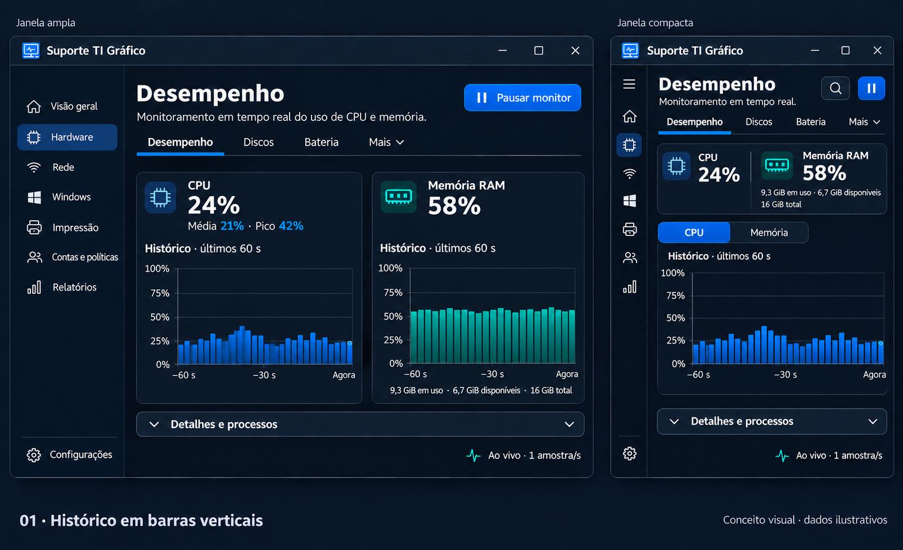
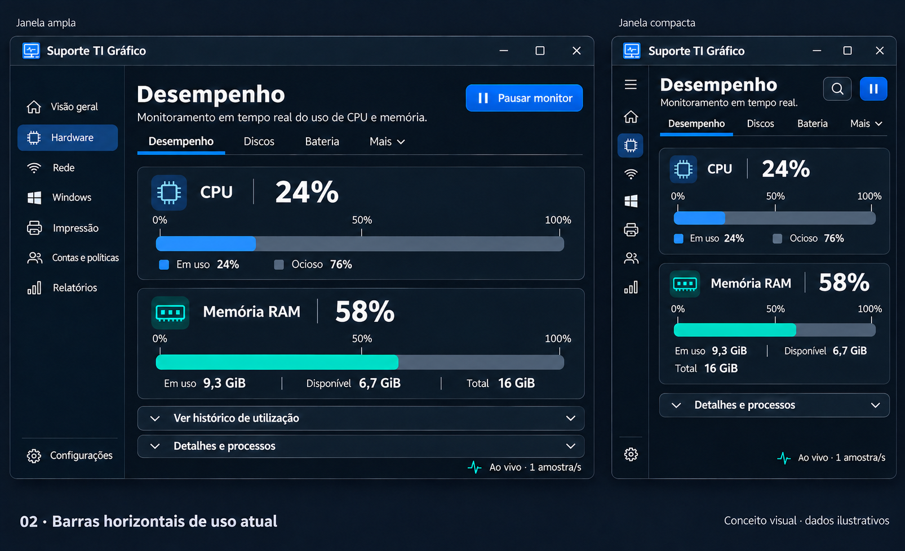
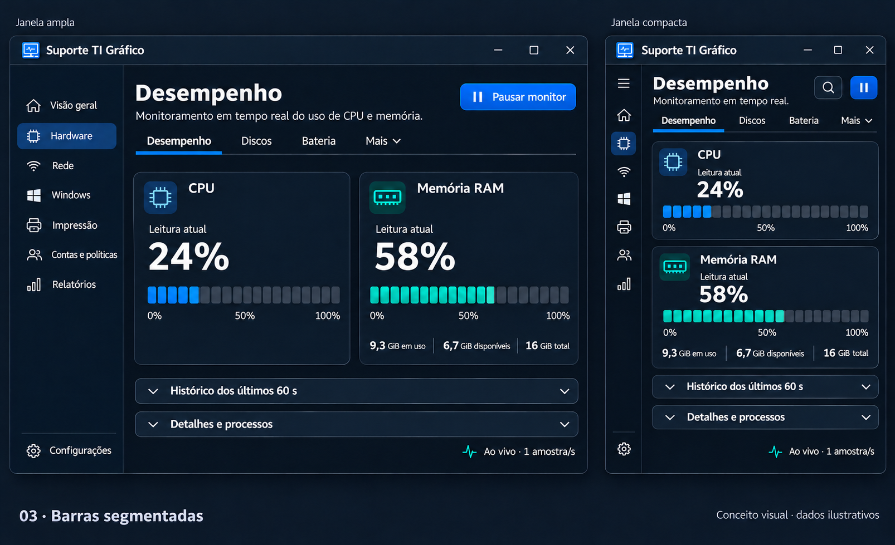
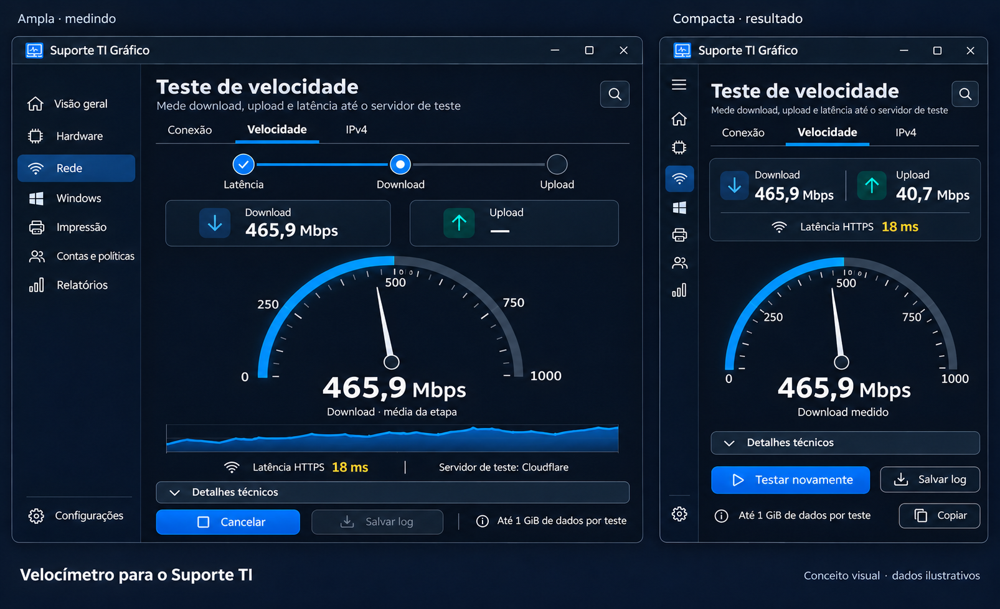

# CPU e memória: três propostas em barras

**Conceitos para avaliação, no estilo Dashboard de monitoramento escolhido pelo usuário.** Cada imagem compara uma janela ampla e uma compacta. Os números são ilustrativos; não representam uma leitura real. Imagens geradas com a ferramenta integrada **imagegen**. [Prompts completos](prompts.json).

## Pesquisa e critério

Foram consultados os exemplos de [barras e séries da galeria LiveCharts2 para WinForms](https://www.livecharts.dev/docs/winforms/2.0.4/gallery), a documentação de [gráficos em barras do Grafana](https://grafana.com/docs/grafana/latest/visualizations/panels-visualizations/visualizations/bar-chart/) e os [indicadores de barra do Grafana](https://grafana.com/docs/grafana/latest/visualizations/panels-visualizations/visualizations/bar-gauge/).

A distinção importante é entre **histórico**, que mantém a sequência temporal das amostras, e **indicador de uso atual**, que mostra um único valor numa faixa. As duas apresentações podem ser úteis, mas respondem a perguntas diferentes. Para CPU/RAM em percentual, a proposta fixa os limites em 0 e 100; ajustar automaticamente a escala ao maior valor observado distorceria a comparação visual.

As referências orientam o desenho, não obrigam a instalar Grafana ou uma biblioteca. Nenhuma dependência foi adicionada e nenhum desempenho foi medido nesta etapa.

## 1. Histórico em barras verticais

Cada coluna representa um intervalo de medição. Permite perceber variação e picos recentes. Na janela ampla, CPU e memória aparecem lado a lado; na compacta, os dois valores atuais permanecem visíveis e o histórico é alternado por CPU/Memória.

Para implementar, definir claramente a duração de cada coluna e qualquer agregação usada para caber na largura disponível. Não preencher lacunas com zeros nem criar amostras. A coleta atual por segundo pode ser preservada independentemente da quantidade de colunas desenhadas.

## 2. Barras horizontais de uso atual

Apresentação direta do percentual atual: CPU em uso e capacidade ociosa; memória em uso, disponível e total. Na compacta, os cartões são empilhados e continuam mostrando ambos os recursos. O histórico fica sob demanda.

É minha recomendação para a visualização padrão quando a prioridade é reduzir a quantidade de informação simultânea. A opção 1 pode ser oferecida ao expandir o histórico. Memória disponível não deve ser rotulada simplesmente como memória livre, pois os conceitos não são equivalentes.

## 3. Barras segmentadas

O percentual aparece em blocos, com identidade visual mais marcada. Na compacta, ambos os recursos permanecem acessíveis em cartões empilhados. Histórico e detalhes ficam recolhidos.

A implementação deve calcular preenchimento parcial do último segmento para manter coerência com o número exato. A imagem é uma referência estética, não uma especificação da contagem de segmentos. Não usar cores de alerta aleatórias nem converter percentual de uso em diagnóstico automático de saúde.

## Regras comuns propostas

- Manter a fonte legível e alterar a composição conforme a largura útil da janela.
- Conservar os percentuais atuais de CPU e RAM à vista nos modos compactos.
- Usar azul para CPU e verde-água para RAM, com contraste e identificação textual.
- Mostrar memória usada, disponível e total com unidades consistentes.
- Manter pausa do monitor, histórico e detalhes acessíveis por teclado.
- Animar apenas a apresentação entre amostras reais e respeitar redução de movimento.
- Preservar estados sem leitura, falha e pausa; não inventar valores durante indisponibilidade.
- Validar consumo, DPI e redimensionamento no protótipo; imagens estáticas não comprovam responsividade ou impacto de desempenho.

## Proposta complementar de rede

Também foi preparado um [modelo com velocímetro para o teste de internet](../menus-responsivos/03-rede-velocimetro.png), com a referência de composição do [Speedtest oficial para Windows](https://apps.microsoft.com/detail/9nblggh4z1jc). A imagem compara uma janela ampla em medição com uma compacta exibindo resultado.

O modelo usa a identidade do Suporte TI, valor em Mbps, fases e resultados de download/upload. A referência é visual: não representa integração com servidores ou metodologia da Ookla. A medição atual continua sendo o motor C# do aplicativo com Cloudflare, e a latência é identificada como HTTPS. O movimento do ponteiro deve acompanhar a taxa medida, sem números aleatórios. Antes de iniciar, o controle pode apresentar Iniciar; durante o teste, Cancelar; ao terminar, Testar novamente e Salvar log.

Esta revisão adiciona somente conceitos e documentação. A escolha das barras e do velocímetro ainda depende da avaliação do usuário; não altera a versão do aplicativo nem as capturas reais de distribuição.
