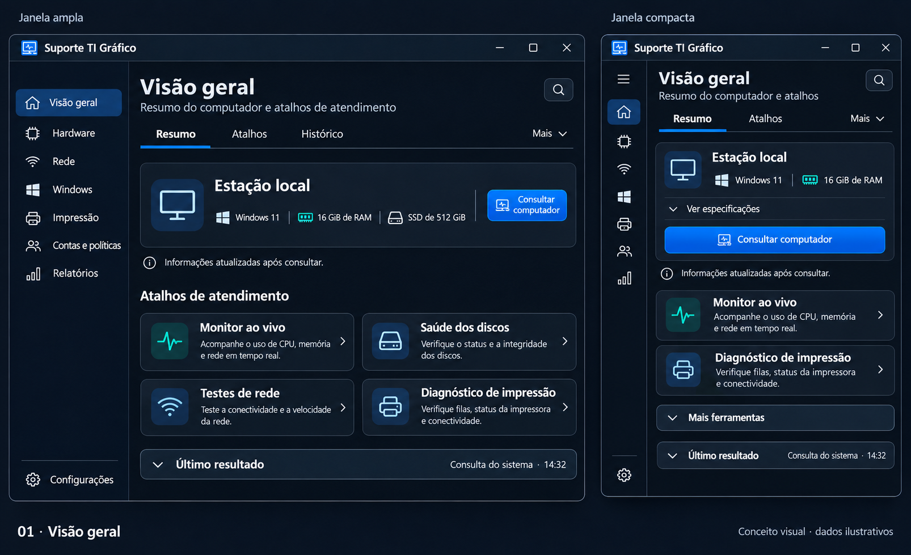
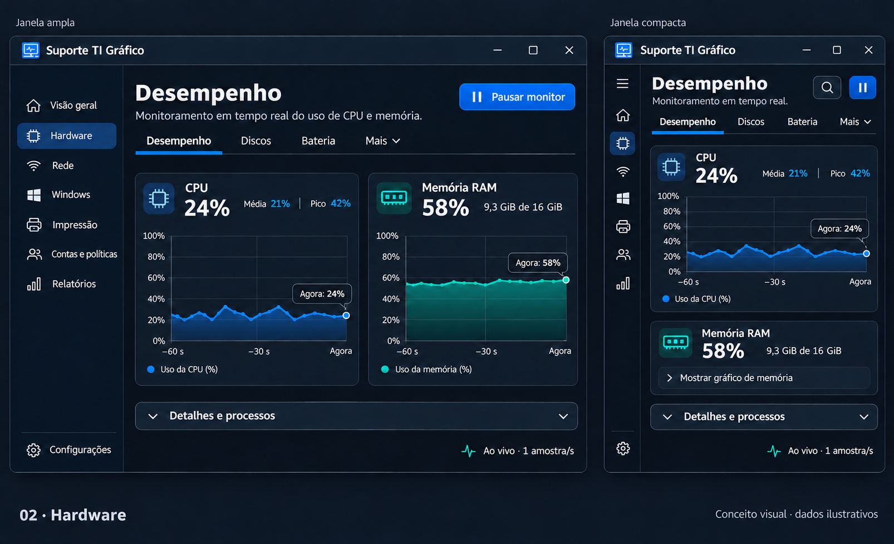
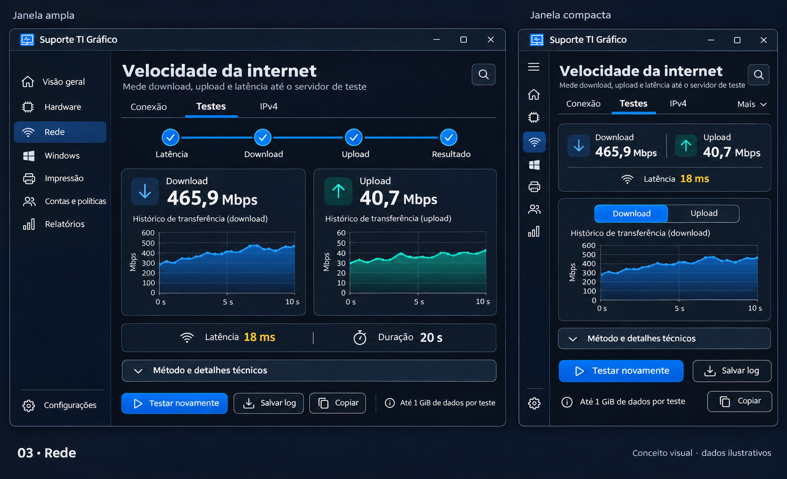
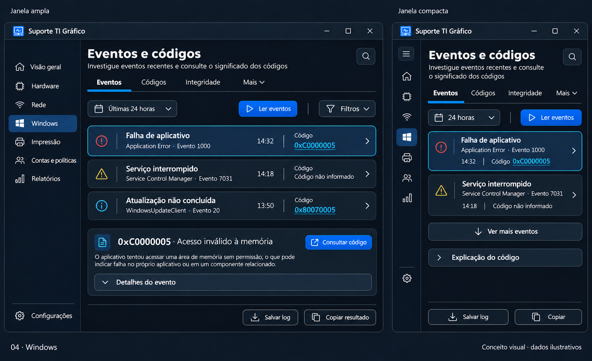
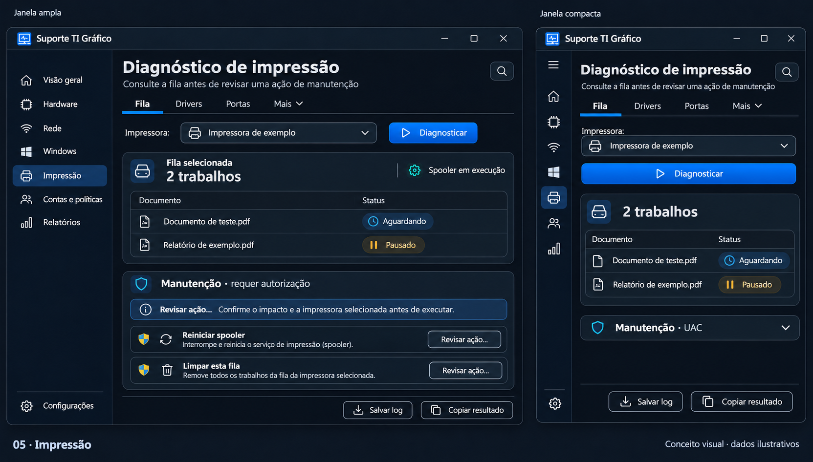

# Cinco menus no estilo Dashboard de monitoramento

**Direção visual escolhida pelo usuário: proposta 2. Organização das telas ainda em avaliação.**

Cada imagem compara a mesma área em uma janela ampla e em uma compacta. São conceitos gerados com a ferramenta integrada **imagegen**, com dados ilustrativos; não são capturas de uma atualização implementada. Os [prompts e ajustes](prompts.json) estão preservados.

## 1. Visão geral

Resumo do computador e atalhos por tarefa. Na janela compacta, especificações secundárias e parte dos atalhos ficam expansíveis. A consulta principal permanece visível.

## 2. Hardware

**Complemento posterior:** veja também as [três alternativas com gráficos em barras para CPU e memória](../hardware-barras/README.md).

CPU e memória lado a lado na janela ampla. Na compacta, CPU conserva o gráfico e a memória mantém leitura atual, usada/total e uma opção para expandir seu gráfico. Processos e detalhes permanecem recolhidos.

## 3. Rede

**Alternativa posterior:** [velocímetro inspirado na composição do Speedtest](03-rede-velocimetro.png), preservando a identidade do aplicativo e a medição atual.

Download e upload têm o mesmo destaque. Na compacta, os valores continuam visíveis, mas apenas uma curva aparece por vez; um seletor permite alternar o histórico. Consumo de dados, teste e salvamento do log permanecem acessíveis.

## 4. Windows

Eventos apresentados por cartões, distinguindo origem, ID de evento e código de erro. Na compacta, aparecem menos registros e a explicação fica expansível. A versão final da imagem mantém Ler eventos, período, Salvar log e cópia acessíveis.

## 5. Impressão

Impressora, trabalhos e diagnóstico formam o conteúdo principal. Manutenção fica separada e identificada com UAC; a compacta mostra essa seção recolhida. Reiniciar spooler e remover trabalhos da fila continuam ações distintas, com revisão antes de executar.

## Regras propostas para adaptação

- Usar a largura útil da janela para ajustar a composição, preservando uma fonte legível.
- Recolher a navegação lateral, com botão de expansão, rótulos acessíveis e identificação da área atual.
- Reduzir colunas e mostrar menos detalhes simultaneamente; não apenas reduzir a escala de toda a tela.
- Manter uma linha estável de guias e um menu Mais para excedentes.
- Conservar ação principal, cancelamento quando aplicável, salvamento de logs e avisos de impacto acessíveis.
- Expandir informações secundárias sob demanda, com rolagem quando necessária. Recolher não deve excluir dados dos relatórios.
- Preservar navegação por teclado, foco e leitores de tela, inclusive em controles reduzidos a ícones.

As proporções dos mockups não definem uma resolução mínima nem comprovam responsividade real. Os pontos de quebra, a redução de movimento e o desempenho precisarão ser validados no protótipo e na implementação, incluindo a janela mínima atual e escalas de 100%, 125%, 150% e 200%. Rótulos ilustrativos, como Histórico, Drivers ou Portas, dependem do mapeamento às ferramentas e dados existentes; não representam novas funções já entregues.

A revisão produziu somente imagens e documentação. Mantém os arquivos do aplicativo, sua versão e as imagens reais do README de distribuição.
